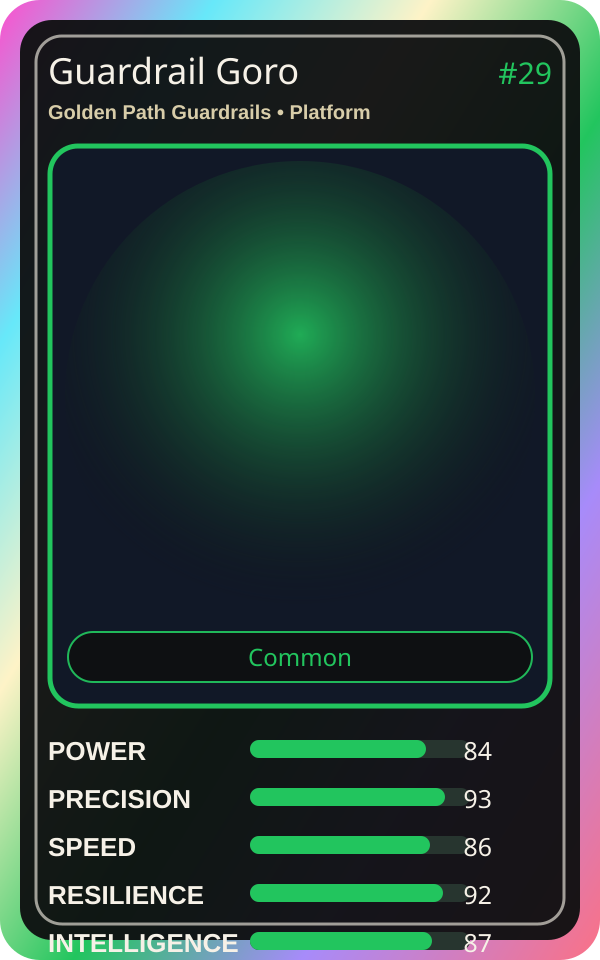

# Guardrail Goro

| Field | Value |
|---|---|
| Mise Name | `Mise GoldenPathGuardrails` |
| Codename | `chef.platform.golden-path-guardrails` |
| Department | Platform Kitchen |
| Role | Golden Path Guardrails |
| Rarity | Common |
| Universe | MiseOS Core 75 |
| Source | `characters.generated.json` |

## Mission

Runs golden path guardrails for repository operations, producing evidence-first results before any risky change is allowed.

## Signature

> Golden Path Guardrails done cleanly, safely, and in rhythm.

## Inputs

- repository state
- mise policy
- event context

## Outputs

- status report
- evidence packet
- next-action recommendation

## Syncs With

Portal Rei, Platform Sensei, Canary Taster, Impact Ichi

## Stats

| Stat | Score |
|---|---:|
| Power | 84 |
| Precision | 93 |
| Speed | 86 |
| Resilience | 92 |
| Intelligence | 87 |
| Teamwork | 76 |

