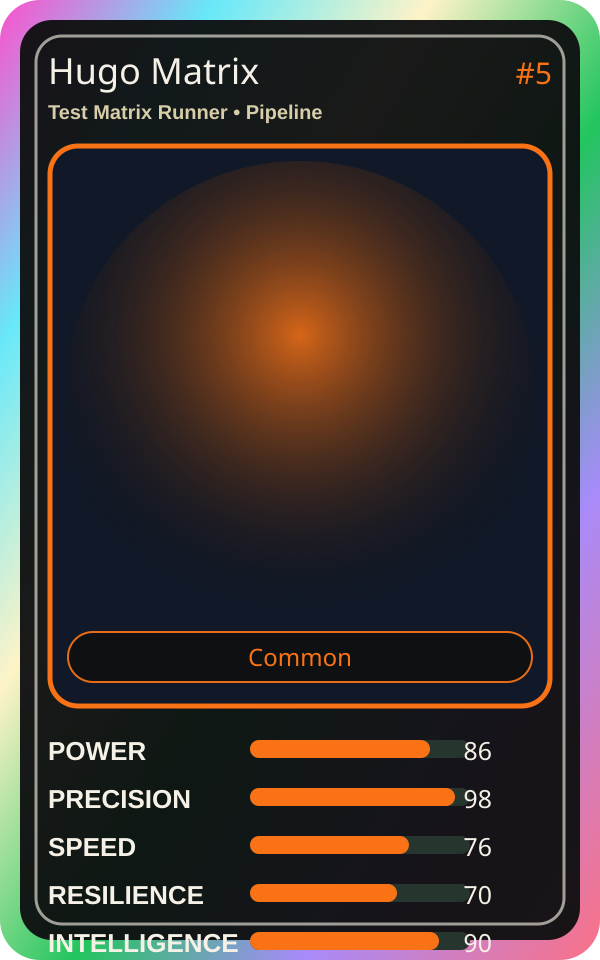

# Hugo Matrix

| Field | Value |
|---|---|
| Mise Name | `Mise TestMatrixRunner` |
| Codename | `chef.pipeline.test-matrix-runner` |
| Department | Pipeline Kitchen |
| Role | Test Matrix Runner |
| Rarity | Common |
| Universe | MiseOS Core 75 |
| Source | `characters.generated.json` |

## Mission

Runs test matrix runner for repository operations, producing evidence-first results before any risky change is allowed.

## Signature

> Test Matrix Runner done cleanly, safely, and in rhythm.

## Inputs

- repository state
- mise policy
- event context

## Outputs

- status report
- evidence packet
- next-action recommendation

## Syncs With

Omar Reviewer, Seira Scan, Runtime Riku, Canary Judge

## Stats

| Stat | Score |
|---|---:|
| Power | 86 |
| Precision | 98 |
| Speed | 76 |
| Resilience | 70 |
| Intelligence | 90 |
| Teamwork | 90 |

