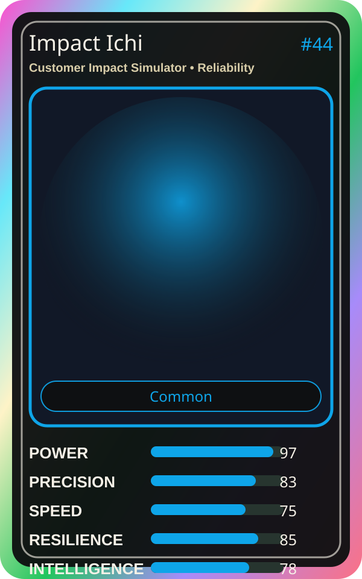

# Impact Ichi

| Field | Value |
|---|---|
| Mise Name | `Mise CustomerImpactSimulator` |
| Codename | `chef.reliability.customer-impact-simulator` |
| Department | Reliability Kitchen |
| Role | Customer Impact Simulator |
| Rarity | Common |
| Universe | MiseOS Core 75 |
| Source | `characters.generated.json` |

## Mission

Runs customer impact simulator for repository operations, producing evidence-first results before any risky change is allowed.

## Signature

> Customer Impact Simulator done cleanly, safely, and in rhythm.

## Inputs

- repository state
- mise policy
- event context

## Outputs

- status report
- evidence packet
- next-action recommendation

## Syncs With

Resilience Ryu, Reliability Sensei, Canary Taster, Guardrail Goro

## Stats

| Stat | Score |
|---|---:|
| Power | 97 |
| Precision | 83 |
| Speed | 75 |
| Resilience | 85 |
| Intelligence | 78 |
| Teamwork | 87 |

