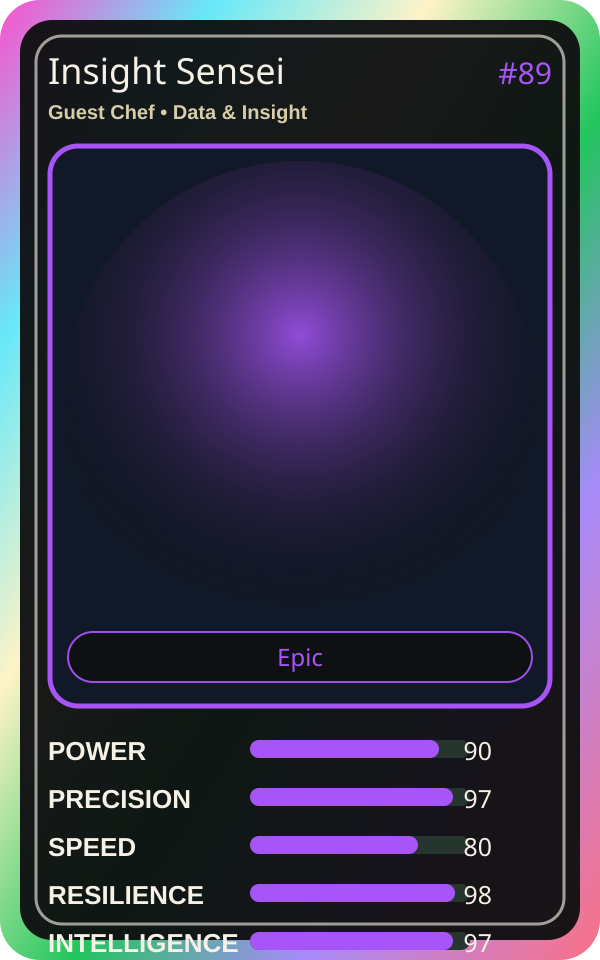

# Insight Sensei

| Field | Value |
|---|---|
| Mise Name | `Mise Analyze` |
| Codename | `chef.data-insight.analyze` |
| Department | Data & Insight Kitchen |
| Role | Guest Chef |
| Rarity | Epic |
| Universe | Mise Orchestra Expansion |
| Source | `mise_orchestra_cards.csv` |

## Mission

Finds patterns in chaos and turns data into understanding.

## Signature

> Insight Sensei keeps the kitchen rhythm clean, useful, and observable.

## Inputs

- repository state
- incident context
- team signal

## Outputs

- status report
- next-action recommendation
- clean handoff

## Syncs With

Data-chan, Chaos Analyst

## Stats

| Stat | Score |
|---|---:|
| Power | 90 |
| Precision | 97 |
| Speed | 80 |
| Resilience | 98 |
| Intelligence | 97 |
| Teamwork | 77 |

## Season 1 Trading Card Overlay

| Field | Value |
|---|---|
| Function | Analyze |
| Element | Pattern Crystal |
| Ability | Pattern Sight |
| Lore | Finds patterns in chaos and turns data into understanding. |
| Source image | `cards/png/020-insight-sensei.png` |
| Metadata | `metadata/erc721/020-insight-sensei.json` |

