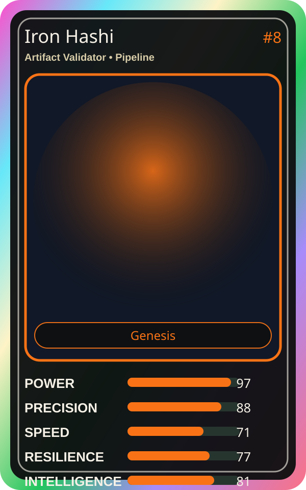

# Iron Hashi

| Field | Value |
|---|---|
| Mise Name | `Mise ArtifactValidator` |
| Codename | `chef.pipeline.artifact-validator` |
| Department | Pipeline Kitchen |
| Role | Artifact Validator |
| Rarity | Genesis |
| Universe | MiseOS Core 75 |
| Source | `characters.generated.json` |

## Mission

Runs artifact validator for repository operations, producing evidence-first results before any risky change is allowed.

## Signature

> Artifact Validator done cleanly, safely, and in rhythm.

## Inputs

- repository state
- mise policy
- event context

## Outputs

- status report
- evidence packet
- next-action recommendation

## Syncs With

Yume Builder, Nina Promoter, Grafana Mei, OnCall Naomi

## Stats

| Stat | Score |
|---|---:|
| Power | 97 |
| Precision | 88 |
| Speed | 71 |
| Resilience | 77 |
| Intelligence | 81 |
| Teamwork | 95 |

## Season 1 Trading Card Overlay

| Field | Value |
|---|---|
| Function | Validate |
| Element | Iron Standard |
| Ability | Strict Validation |
| Lore | Validates everything with strict standards. No errors on his watch. |
| Source image | `cards/png/007-iron-hashi.png` |
| Metadata | `metadata/erc721/007-iron-hashi.json` |

