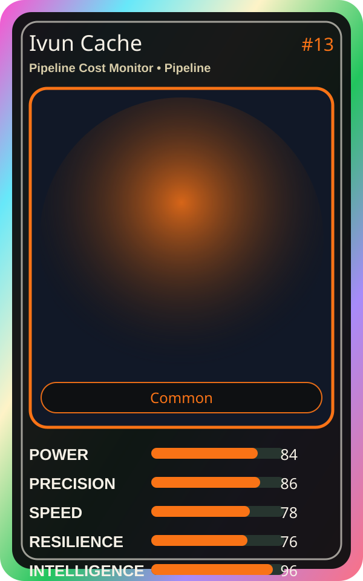

# Ivun Cache

| Field | Value |
|---|---|
| Mise Name | `Mise PipelineCostMonitor` |
| Codename | `chef.pipeline.pipeline-cost-monitor` |
| Department | Pipeline Kitchen |
| Role | Pipeline Cost Monitor |
| Rarity | Common |
| Universe | MiseOS Core 75 |
| Source | `characters.generated.json` |

## Mission

Runs pipeline cost monitor for repository operations, producing evidence-first results before any risky change is allowed.

## Signature

> Pipeline Cost Monitor done cleanly, safely, and in rhythm.

## Inputs

- repository state
- mise policy
- event context

## Outputs

- status report
- evidence packet
- next-action recommendation

## Syncs With

Tariq Notesmith, Canary Taster, Portal Rei, Resilience Ryu

## Stats

| Stat | Score |
|---|---:|
| Power | 84 |
| Precision | 86 |
| Speed | 78 |
| Resilience | 76 |
| Intelligence | 96 |
| Teamwork | 84 |

