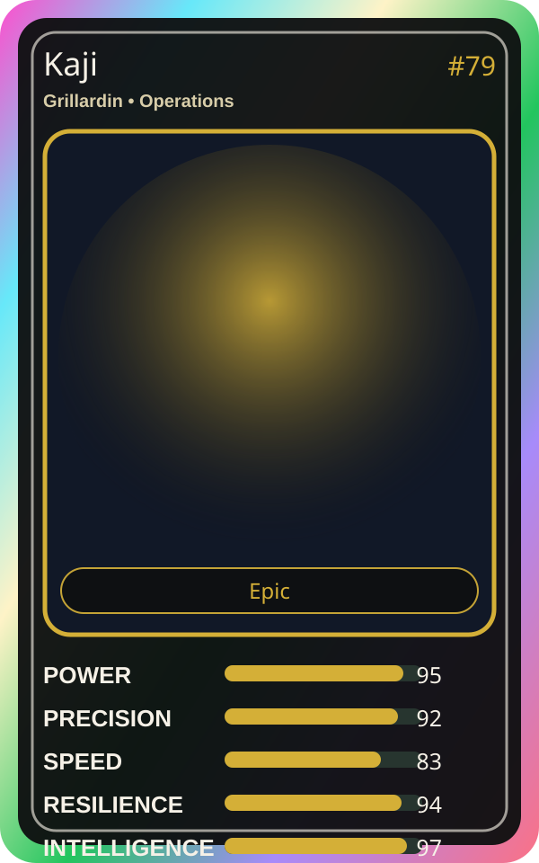

# Kaji

| Field | Value |
|---|---|
| Mise Name | `Mise Compute` |
| Codename | `chef.operations.compute` |
| Department | Operations Kitchen |
| Role | Grillardin |
| Rarity | Epic |
| Universe | Mise Orchestra Expansion |
| Source | `mise_orchestra_cards.csv` |

## Mission

Handles the heat and powers the compute line with blazing passion.

## Signature

> Kaji keeps the kitchen rhythm clean, useful, and observable.

## Inputs

- repository state
- incident context
- team signal

## Outputs

- status report
- next-action recommendation
- clean handoff

## Syncs With

Mizu, Scale Oni

## Stats

| Stat | Score |
|---|---:|
| Power | 95 |
| Precision | 92 |
| Speed | 83 |
| Resilience | 94 |
| Intelligence | 97 |
| Teamwork | 87 |

## Season 1 Trading Card Overlay

| Field | Value |
|---|---|
| Function | Compute |
| Element | Fire |
| Ability | Blazing Compute |
| Lore | Handles the heat and powers the compute line with blazing passion. |
| Source image | `cards/png/005-kaji.png` |
| Metadata | `metadata/erc721/005-kaji.json` |

