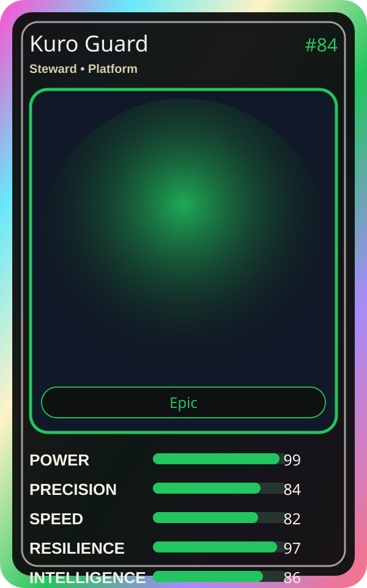

# Kuro Guard

| Field | Value |
|---|---|
| Mise Name | `Mise Protect` |
| Codename | `chef.platform.protect` |
| Department | Platform Kitchen |
| Role | Steward |
| Rarity | Epic |
| Universe | Mise Orchestra Expansion |
| Source | `mise_orchestra_cards.csv` |

## Mission

Defends the platform with unwavering protection.

## Signature

> Kuro Guard keeps the kitchen rhythm clean, useful, and observable.

## Inputs

- repository state
- incident context
- team signal

## Outputs

- status report
- next-action recommendation
- clean handoff

## Syncs With

Seira, Orchestra Core

## Stats

| Stat | Score |
|---|---:|
| Power | 99 |
| Precision | 84 |
| Speed | 82 |
| Resilience | 97 |
| Intelligence | 86 |
| Teamwork | 81 |

## Season 1 Trading Card Overlay

| Field | Value |
|---|---|
| Function | Protect |
| Element | Black Shield |
| Ability | Platform Ward |
| Lore | Defends the platform with unwavering protection. |
| Source image | `cards/png/011-kuro-guard.png` |
| Metadata | `metadata/erc721/011-kuro-guard.json` |

