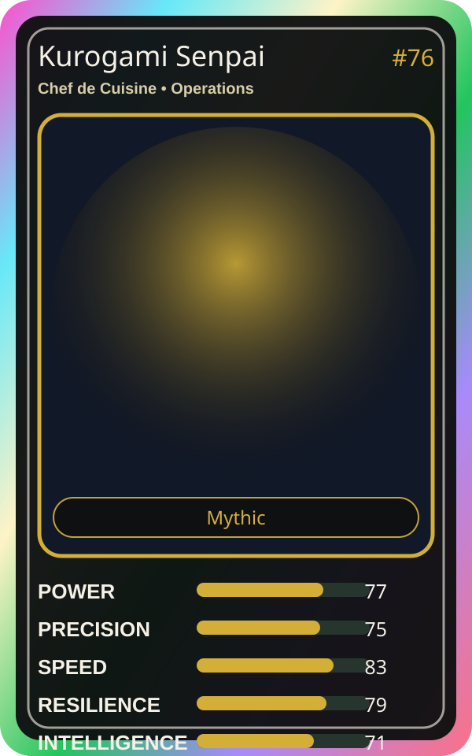

# Kurogami Senpai

| Field | Value |
|---|---|
| Mise Name | `Mise Orchestrate` |
| Codename | `chef.operations.orchestrate` |
| Department | Operations Kitchen |
| Role | Chef de Cuisine |
| Rarity | Mythic |
| Universe | Mise Orchestra Expansion |
| Source | `mise_orchestra_cards.csv` |

## Mission

Plans every move with perfect precision before the kitchen heats up.

## Signature

> Kurogami Senpai keeps the kitchen rhythm clean, useful, and observable.

## Inputs

- repository state
- incident context
- team signal

## Outputs

- status report
- next-action recommendation
- clean handoff

## Syncs With

Scale Oni, Mizu

## Stats

| Stat | Score |
|---|---:|
| Power | 77 |
| Precision | 75 |
| Speed | 83 |
| Resilience | 79 |
| Intelligence | 71 |
| Teamwork | 85 |

## Season 1 Trading Card Overlay

| Field | Value |
|---|---|
| Function | Orchestrate |
| Element | Gold Flame |
| Ability | Master Orchestrator |
| Lore | Plans every move with perfect precision before the kitchen heats up. |
| Source image | `cards/png/001-kurogami-senpai.png` |
| Metadata | `metadata/erc721/001-kurogami-senpai.json` |

