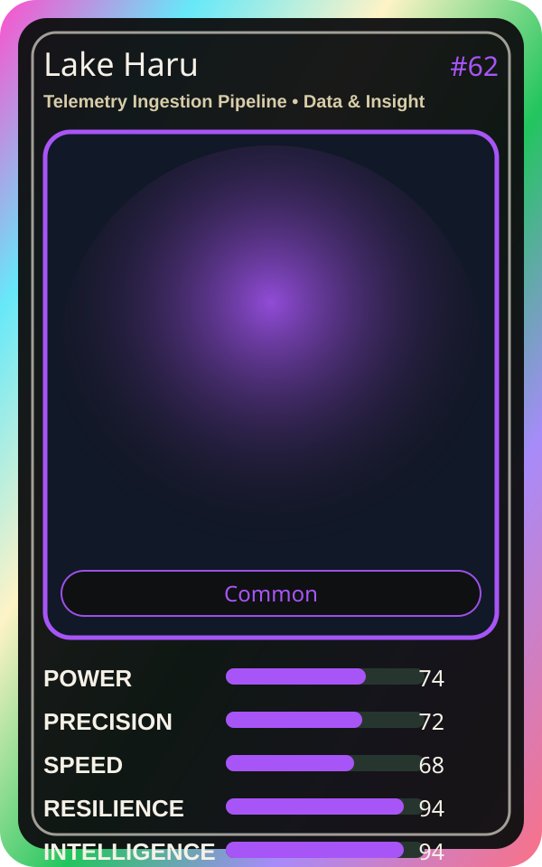

# Lake Haru

| Field | Value |
|---|---|
| Mise Name | `Mise TelemetryIngestionPipeline` |
| Codename | `chef.data-insight.telemetry-ingestion-pipeline` |
| Department | Data & Insight Kitchen |
| Role | Telemetry Ingestion Pipeline |
| Rarity | Common |
| Universe | MiseOS Core 75 |
| Source | `characters.generated.json` |

## Mission

Runs telemetry ingestion pipeline for repository operations, producing evidence-first results before any risky change is allowed.

## Signature

> Telemetry Ingestion Pipeline done cleanly, safely, and in rhythm.

## Inputs

- repository state
- mise policy
- event context

## Outputs

- status report
- evidence packet
- next-action recommendation

## Syncs With

Taxonomy Taka, Lattice, Bruno Blast-Radius, Bootstrap Aiko

## Stats

| Stat | Score |
|---|---:|
| Power | 74 |
| Precision | 72 |
| Speed | 68 |
| Resilience | 94 |
| Intelligence | 94 |
| Teamwork | 88 |

