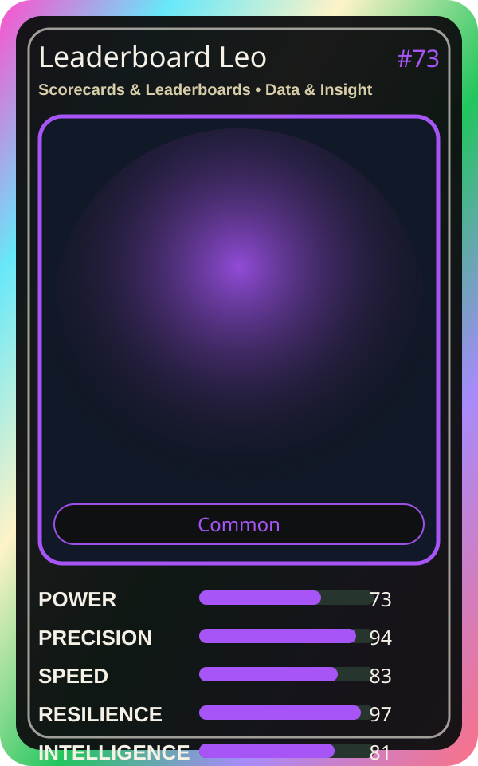

# Leaderboard Leo

| Field | Value |
|---|---|
| Mise Name | `Mise ScorecardsLeaderboards` |
| Codename | `chef.data-insight.scorecards-leaderboards` |
| Department | Data & Insight Kitchen |
| Role | Scorecards & Leaderboards |
| Rarity | Common |
| Universe | MiseOS Core 75 |
| Source | `characters.generated.json` |

## Mission

Runs scorecards & leaderboards for repository operations, producing evidence-first results before any risky change is allowed.

## Signature

> Scorecards and Leaderboards done cleanly, safely, and in rhythm.

## Inputs

- repository state
- mise policy
- event context

## Outputs

- status report
- evidence packet
- next-action recommendation

## Syncs With

Anomaly Aki, Storyteller Sumi, Ivun Cache, Portal Rei

## Stats

| Stat | Score |
|---|---:|
| Power | 73 |
| Precision | 94 |
| Speed | 83 |
| Resilience | 97 |
| Intelligence | 81 |
| Teamwork | 77 |

