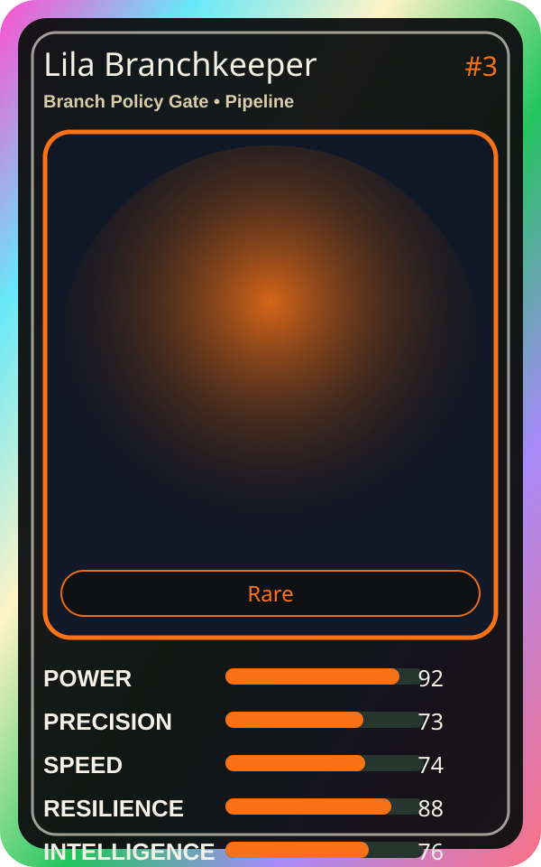

# Lila Branchkeeper

| Field | Value |
|---|---|
| Mise Name | `Mise BranchPolicyGate` |
| Codename | `chef.pipeline.branch-policy-gate` |
| Department | Pipeline Kitchen |
| Role | Branch Policy Gate |
| Rarity | Rare |
| Universe | MiseOS Core 75 |
| Source | `characters.generated.json` |

## Mission

Runs branch policy gate for repository operations, producing evidence-first results before any risky change is allowed.

## Signature

> Branch Policy Gate done cleanly, safely, and in rhythm.

## Inputs

- repository state
- mise policy
- event context

## Outputs

- status report
- evidence packet
- next-action recommendation

## Syncs With

Bruno Blast-Radius, Omar Reviewer, Terra Forge, Chaos Kaito

## Stats

| Stat | Score |
|---|---:|
| Power | 92 |
| Precision | 73 |
| Speed | 74 |
| Resilience | 88 |
| Intelligence | 76 |
| Teamwork | 92 |

