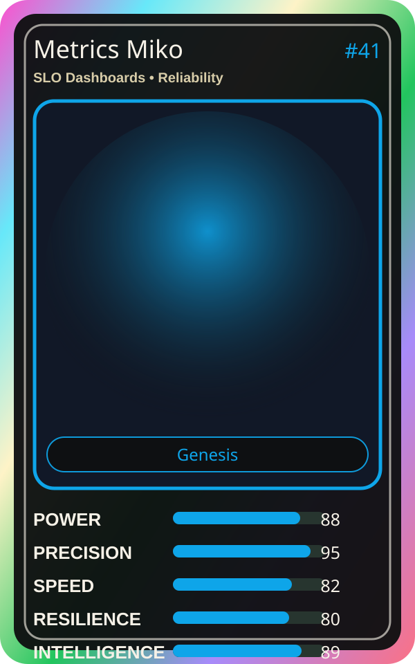

# Metrics Miko

| Field | Value |
|---|---|
| Mise Name | `Mise SloDashboards` |
| Codename | `chef.reliability.slo-dashboards` |
| Department | Reliability Kitchen |
| Role | SLO Dashboards |
| Rarity | Genesis |
| Universe | MiseOS Core 75 |
| Source | `characters.generated.json` |

## Mission

Runs slo dashboards for repository operations, producing evidence-first results before any risky change is allowed.

## Signature

> SLO Dashboards done cleanly, safely, and in rhythm.

## Inputs

- repository state
- mise policy
- event context

## Outputs

- status report
- evidence packet
- next-action recommendation

## Syncs With

Backlog Benji, Forecast Fuji, Felix Rollback, Streama

## Stats

| Stat | Score |
|---|---:|
| Power | 88 |
| Precision | 95 |
| Speed | 82 |
| Resilience | 80 |
| Intelligence | 89 |
| Teamwork | 84 |

## Season 1 Trading Card Overlay

| Field | Value |
|---|---|
| Function | Measure |
| Element | Signal Clock |
| Ability | Metric Reading |
| Lore | Reads the numbers. Metrics guide every decision. |
| Source image | `cards/png/017-metrics-miko.png` |
| Metadata | `metadata/erc721/017-metrics-miko.json` |

