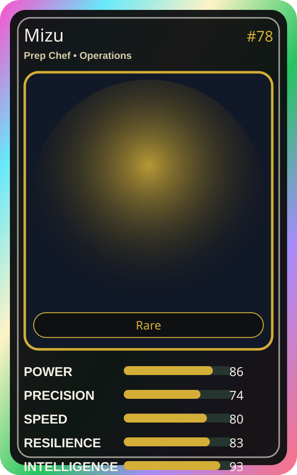

# Mizu

| Field | Value |
|---|---|
| Mise Name | `Mise Prepare` |
| Codename | `chef.operations.prepare` |
| Department | Operations Kitchen |
| Role | Prep Chef |
| Rarity | Rare |
| Universe | Mise Orchestra Expansion |
| Source | `mise_orchestra_cards.csv` |

## Mission

Prepares everything in advance. Organization is the recipe.

## Signature

> Mizu keeps the kitchen rhythm clean, useful, and observable.

## Inputs

- repository state
- incident context
- team signal

## Outputs

- status report
- next-action recommendation
- clean handoff

## Syncs With

Kurogami Senpai, Kaji

## Stats

| Stat | Score |
|---|---:|
| Power | 86 |
| Precision | 74 |
| Speed | 80 |
| Resilience | 83 |
| Intelligence | 93 |
| Teamwork | 73 |

## Season 1 Trading Card Overlay

| Field | Value |
|---|---|
| Function | Prepare |
| Element | Blue Water |
| Ability | Prep Ledger |
| Lore | Prepares everything in advance. Organization is the recipe. |
| Source image | `cards/png/003-mizu.png` |
| Metadata | `metadata/erc721/003-mizu.json` |

