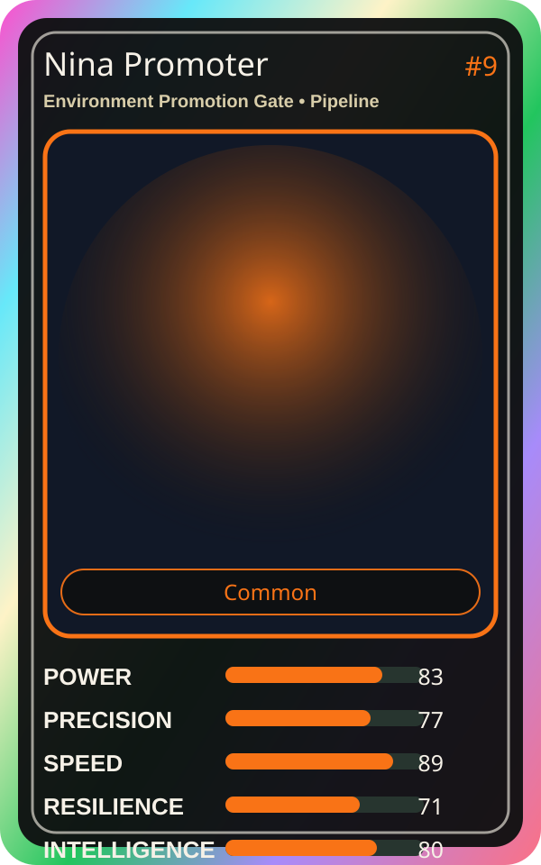

# Nina Promoter

| Field | Value |
|---|---|
| Mise Name | `Mise EnvironmentPromotionGate` |
| Codename | `chef.pipeline.environment-promotion-gate` |
| Department | Pipeline Kitchen |
| Role | Environment Promotion Gate |
| Rarity | Common |
| Universe | MiseOS Core 75 |
| Source | `characters.generated.json` |

## Mission

Runs environment promotion gate for repository operations, producing evidence-first results before any risky change is allowed.

## Signature

> Environment Promotion Gate done cleanly, safely, and in rhythm.

## Inputs

- repository state
- mise policy
- event context

## Outputs

- status report
- evidence packet
- next-action recommendation

## Syncs With

Iron Hashi, Release Conductor, Umami Code, Review Ren

## Stats

| Stat | Score |
|---|---:|
| Power | 83 |
| Precision | 77 |
| Speed | 89 |
| Resilience | 71 |
| Intelligence | 80 |
| Teamwork | 99 |

