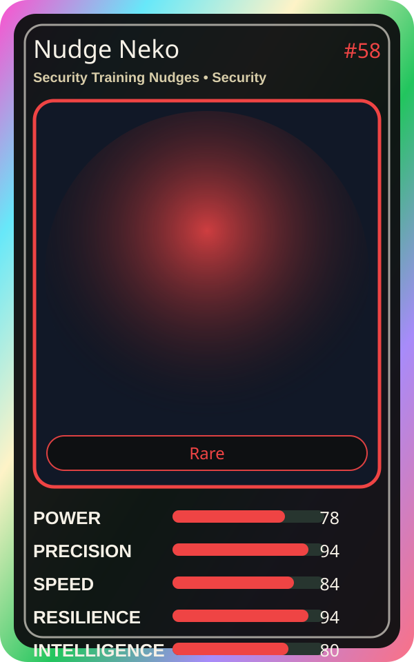

# Nudge Neko

| Field | Value |
|---|---|
| Mise Name | `Mise SecurityTrainingNudges` |
| Codename | `chef.security.security-training-nudges` |
| Department | Security Kitchen |
| Role | Security Training Nudges |
| Rarity | Rare |
| Universe | MiseOS Core 75 |
| Source | `characters.generated.json` |

## Mission

Runs security training nudges for repository operations, producing evidence-first results before any risky change is allowed.

## Signature

> Security Training Nudges done cleanly, safely, and in rhythm.

## Inputs

- repository state
- mise policy
- event context

## Outputs

- status report
- evidence packet
- next-action recommendation

## Syncs With

Evidence Scribe, Scorecard Shin, Ivun Cache, Portal Rei

## Stats

| Stat | Score |
|---|---:|
| Power | 78 |
| Precision | 94 |
| Speed | 84 |
| Resilience | 94 |
| Intelligence | 80 |
| Teamwork | 80 |

