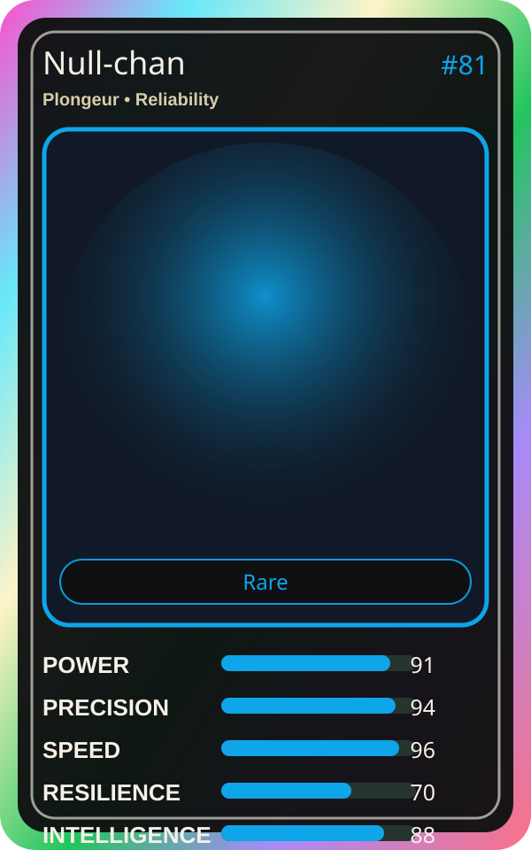

# Null-chan

| Field | Value |
|---|---|
| Mise Name | `Mise Cleanse` |
| Codename | `chef.reliability.cleanse` |
| Department | Reliability Kitchen |
| Role | Plongeur |
| Rarity | Rare |
| Universe | Mise Orchestra Expansion |
| Source | `mise_orchestra_cards.csv` |

## Mission

Cleans up what is not needed. Keeps the kitchen light.

## Signature

> Null-chan keeps the kitchen rhythm clean, useful, and observable.

## Inputs

- repository state
- incident context
- team signal

## Outputs

- status report
- next-action recommendation
- clean handoff

## Syncs With

Reliability Sensei, SLO Sage

## Stats

| Stat | Score |
|---|---:|
| Power | 91 |
| Precision | 94 |
| Speed | 96 |
| Resilience | 70 |
| Intelligence | 88 |
| Teamwork | 70 |

## Season 1 Trading Card Overlay

| Field | Value |
|---|---|
| Function | Cleanse |
| Element | Void Soap |
| Ability | Null Sweep |
| Lore | Cleans up what is not needed. Keeps the kitchen light. |
| Source image | `cards/png/008-null-chan.png` |
| Metadata | `metadata/erc721/008-null-chan.json` |

