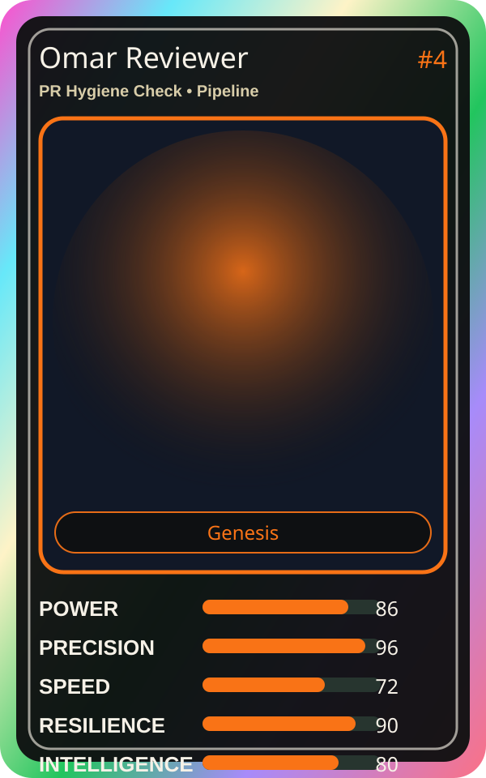

# Omar Reviewer

| Field | Value |
|---|---|
| Mise Name | `Mise PrHygieneCheck` |
| Codename | `chef.pipeline.pr-hygiene-check` |
| Department | Pipeline Kitchen |
| Role | PR Hygiene Check |
| Rarity | Genesis |
| Universe | MiseOS Core 75 |
| Source | `characters.generated.json` |

## Mission

Runs pr hygiene check for repository operations, producing evidence-first results before any risky change is allowed.

## Signature

> PR Hygiene Check done cleanly, safely, and in rhythm.

## Inputs

- repository state
- mise policy
- event context

## Outputs

- status report
- evidence packet
- next-action recommendation

## Syncs With

Lila Branchkeeper, Hugo Matrix, Schema Sora, Capacity Kanna

## Stats

| Stat | Score |
|---|---:|
| Power | 86 |
| Precision | 96 |
| Speed | 72 |
| Resilience | 90 |
| Intelligence | 80 |
| Teamwork | 76 |

