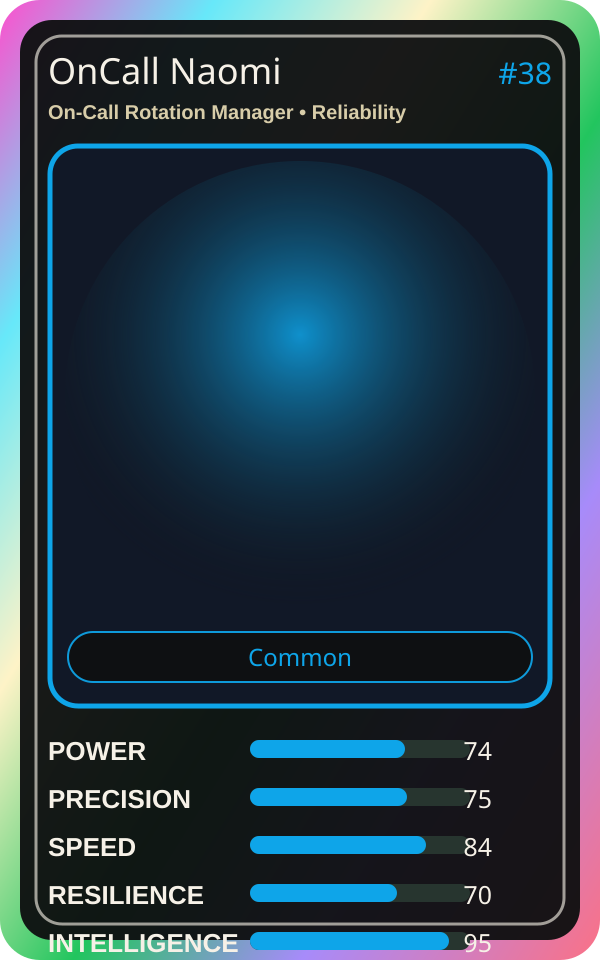

# OnCall Naomi

| Field | Value |
|---|---|
| Mise Name | `Mise OnCallRotationManager` |
| Codename | `chef.reliability.on-call-rotation-manager` |
| Department | Reliability Kitchen |
| Role | On-Call Rotation Manager |
| Rarity | Common |
| Universe | MiseOS Core 75 |
| Source | `characters.generated.json` |

## Mission

Runs on-call rotation manager for repository operations, producing evidence-first results before any risky change is allowed.

## Signature

> On-Call Rotation Manager done cleanly, safely, and in rhythm.

## Inputs

- repository state
- mise policy
- event context

## Outputs

- status report
- evidence packet
- next-action recommendation

## Syncs With

Pager Hiro, Review Ren, Iron Hashi, Grafana Mei

## Stats

| Stat | Score |
|---|---:|
| Power | 74 |
| Precision | 75 |
| Speed | 84 |
| Resilience | 70 |
| Intelligence | 95 |
| Teamwork | 76 |

