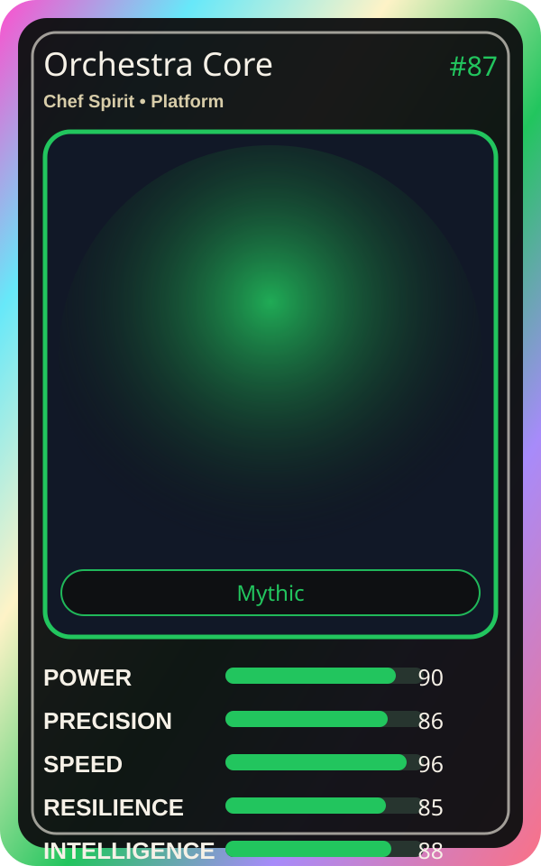

# Orchestra Core

| Field | Value |
|---|---|
| Mise Name | `Mise Coordinate` |
| Codename | `chef.platform.coordinate` |
| Department | Platform Kitchen |
| Role | Chef Spirit |
| Rarity | Mythic |
| Universe | Mise Orchestra Expansion |
| Source | `mise_orchestra_cards.csv` |

## Mission

The soul of the platform. Sees everything and coordinates all.

## Signature

> Orchestra Core keeps the kitchen rhythm clean, useful, and observable.

## Inputs

- repository state
- incident context
- team signal

## Outputs

- status report
- next-action recommendation
- clean handoff

## Syncs With

Kuro Guard, Template Tanaka

## Stats

| Stat | Score |
|---|---:|
| Power | 90 |
| Precision | 86 |
| Speed | 96 |
| Resilience | 85 |
| Intelligence | 88 |
| Teamwork | 94 |

## Season 1 Trading Card Overlay

| Field | Value |
|---|---|
| Function | Coordinate |
| Element | Golden Gate |
| Ability | One Symphony |
| Lore | The soul of the platform. Sees everything and coordinates all. |
| Source image | `cards/png/015-orchestra-core.png` |
| Metadata | `metadata/erc721/015-orchestra-core.json` |

