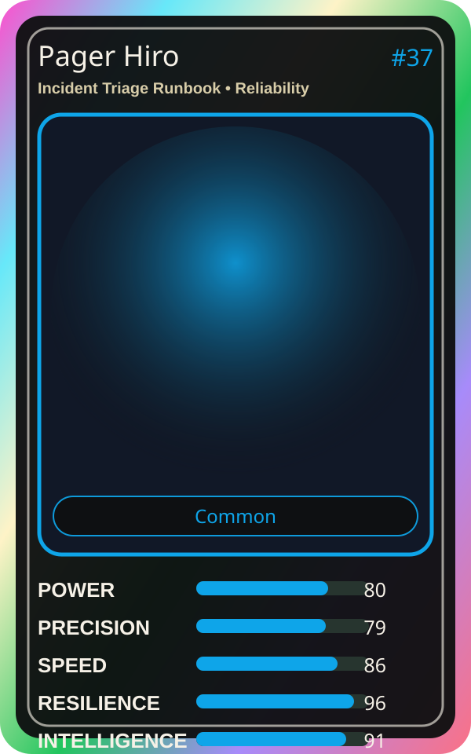

# Pager Hiro

| Field | Value |
|---|---|
| Mise Name | `Mise IncidentTriageRunbook` |
| Codename | `chef.reliability.incident-triage-runbook` |
| Department | Reliability Kitchen |
| Role | Incident Triage Runbook |
| Rarity | Common |
| Universe | MiseOS Core 75 |
| Source | `characters.generated.json` |

## Mission

Runs incident triage runbook for repository operations, producing evidence-first results before any risky change is allowed.

## Signature

> Incident Triage Runbook done cleanly, safely, and in rhythm.

## Inputs

- repository state
- mise policy
- event context

## Outputs

- status report
- evidence packet
- next-action recommendation

## Syncs With

Alert Akira, OnCall Naomi, Yume Builder, Policy Kenji

## Stats

| Stat | Score |
|---|---:|
| Power | 80 |
| Precision | 79 |
| Speed | 86 |
| Resilience | 96 |
| Intelligence | 91 |
| Teamwork | 92 |

