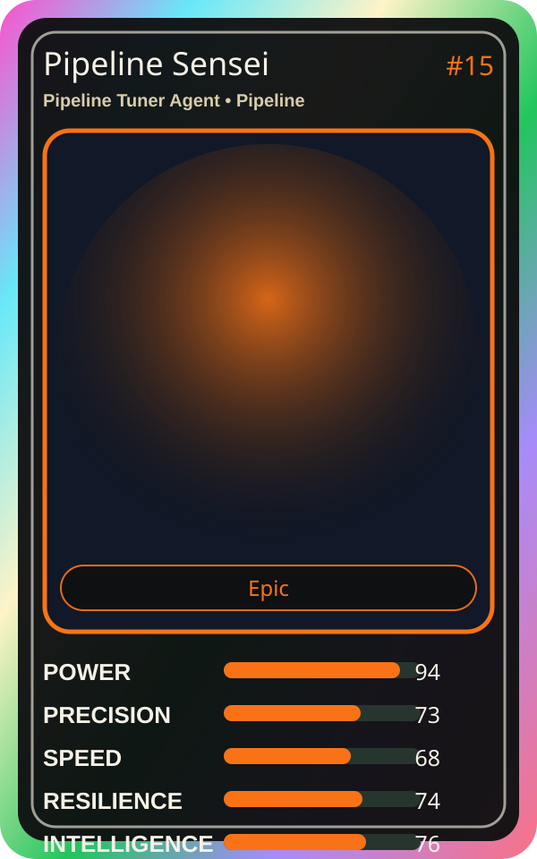

# Pipeline Sensei

| Field | Value |
|---|---|
| Mise Name | `Mise PipelineTunerAgent` |
| Codename | `chef.pipeline.pipeline-tuner-agent` |
| Department | Pipeline Kitchen |
| Role | Pipeline Tuner Agent |
| Rarity | Epic |
| Universe | MiseOS Core 75 |
| Source | `characters.generated.json` |

## Mission

Runs pipeline tuner agent for repository operations, producing evidence-first results before any risky change is allowed.

## Signature

> Pipeline Tuner Agent done cleanly, safely, and in rhythm.

## Inputs

- repository state
- mise policy
- event context

## Outputs

- status report
- evidence packet
- next-action recommendation

## Syncs With

Canary Taster, Platform Sensei, Reliability Sensei, Red Oni

## Stats

| Stat | Score |
|---|---:|
| Power | 94 |
| Precision | 73 |
| Speed | 68 |
| Resilience | 74 |
| Intelligence | 76 |
| Teamwork | 98 |

