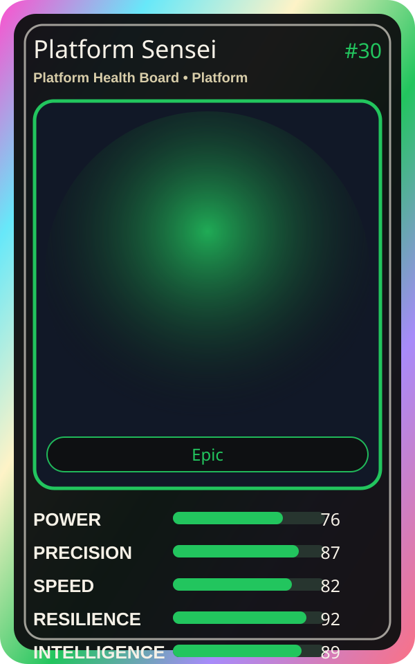

# Platform Sensei

| Field | Value |
|---|---|
| Mise Name | `Mise PlatformHealthBoard` |
| Codename | `chef.platform.platform-health-board` |
| Department | Platform Kitchen |
| Role | Platform Health Board |
| Rarity | Epic |
| Universe | MiseOS Core 75 |
| Source | `characters.generated.json` |

## Mission

Runs platform health board for repository operations, producing evidence-first results before any risky change is allowed.

## Signature

> Platform Health Board done cleanly, safely, and in rhythm.

## Inputs

- repository state
- mise policy
- event context

## Outputs

- status report
- evidence packet
- next-action recommendation

## Syncs With

Guardrail Goro, Pipeline Sensei, Reliability Sensei, Red Oni

## Stats

| Stat | Score |
|---|---:|
| Power | 76 |
| Precision | 87 |
| Speed | 82 |
| Resilience | 92 |
| Intelligence | 89 |
| Teamwork | 82 |

