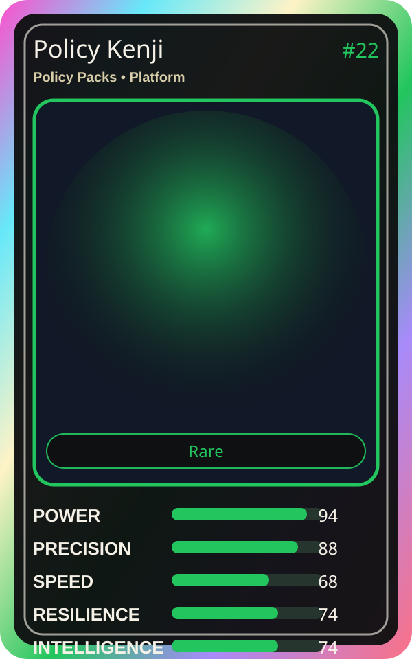

# Policy Kenji

| Field | Value |
|---|---|
| Mise Name | `Mise PolicyPacks` |
| Codename | `chef.platform.policy-packs` |
| Department | Platform Kitchen |
| Role | Policy Packs |
| Rarity | Rare |
| Universe | MiseOS Core 75 |
| Source | `characters.generated.json` |

## Mission

Runs policy packs for repository operations, producing evidence-first results before any risky change is allowed.

## Signature

> Policy Packs done cleanly, safely, and in rhythm.

## Inputs

- repository state
- mise policy
- event context

## Outputs

- status report
- evidence packet
- next-action recommendation

## Syncs With

Vault Hana, Grafana Mei, Yume Builder, Pager Hiro

## Stats

| Stat | Score |
|---|---:|
| Power | 94 |
| Precision | 88 |
| Speed | 68 |
| Resilience | 74 |
| Intelligence | 74 |
| Teamwork | 80 |

