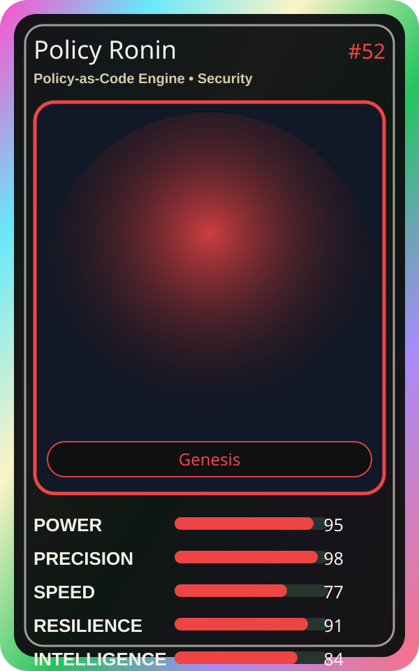

# Policy Ronin

| Field | Value |
|---|---|
| Mise Name | `Mise PolicyAsCodeEngine` |
| Codename | `chef.security.policy-as-code-engine` |
| Department | Security Kitchen |
| Role | Policy-as-Code Engine |
| Rarity | Genesis |
| Universe | MiseOS Core 75 |
| Source | `characters.generated.json` |

## Mission

Runs policy-as-code engine for repository operations, producing evidence-first results before any risky change is allowed.

## Signature

> Policy-as-Code Engine done cleanly, safely, and in rhythm.

## Inputs

- repository state
- mise policy
- event context

## Outputs

- status report
- evidence packet
- next-action recommendation

## Syncs With

Seira Vaultkeeper, Merge Sentinel, Yume Builder, Policy Kenji

## Stats

| Stat | Score |
|---|---:|
| Power | 95 |
| Precision | 98 |
| Speed | 77 |
| Resilience | 91 |
| Intelligence | 84 |
| Teamwork | 81 |

