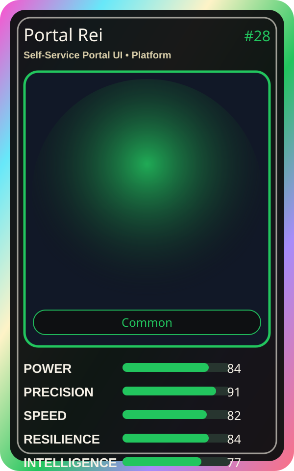

# Portal Rei

| Field | Value |
|---|---|
| Mise Name | `Mise SelfServicePortalUi` |
| Codename | `chef.platform.self-service-portal-ui` |
| Department | Platform Kitchen |
| Role | Self-Service Portal UI |
| Rarity | Common |
| Universe | MiseOS Core 75 |
| Source | `characters.generated.json` |

## Mission

Runs self-service portal ui for repository operations, producing evidence-first results before any risky change is allowed.

## Signature

> Self-Service Portal UI done cleanly, safely, and in rhythm.

## Inputs

- repository state
- mise policy
- event context

## Outputs

- status report
- evidence packet
- next-action recommendation

## Syncs With

Preview Yuki, Guardrail Goro, Ivun Cache, Resilience Ryu

## Stats

| Stat | Score |
|---|---:|
| Power | 84 |
| Precision | 91 |
| Speed | 82 |
| Resilience | 84 |
| Intelligence | 77 |
| Teamwork | 86 |

