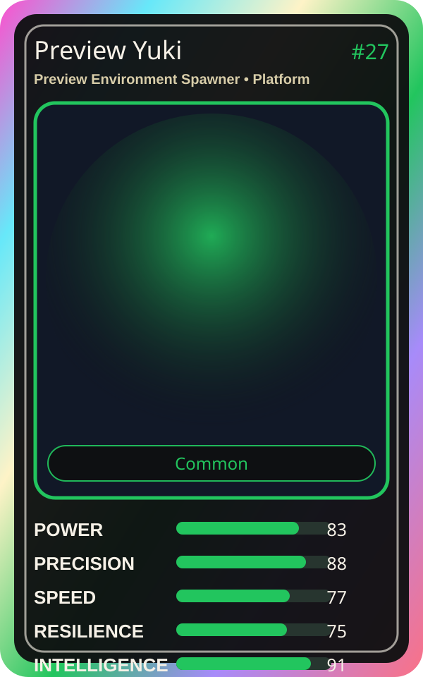

# Preview Yuki

| Field | Value |
|---|---|
| Mise Name | `Mise PreviewEnvironmentSpawner` |
| Codename | `chef.platform.preview-environment-spawner` |
| Department | Platform Kitchen |
| Role | Preview Environment Spawner |
| Rarity | Common |
| Universe | MiseOS Core 75 |
| Source | `characters.generated.json` |

## Mission

Runs preview environment spawner for repository operations, producing evidence-first results before any risky change is allowed.

## Signature

> Preview Environment Spawner done cleanly, safely, and in rhythm.

## Inputs

- repository state
- mise policy
- event context

## Outputs

- status report
- evidence packet
- next-action recommendation

## Syncs With

Streama, Portal Rei, Tariq Notesmith, Forecast Fuji

## Stats

| Stat | Score |
|---|---:|
| Power | 83 |
| Precision | 88 |
| Speed | 77 |
| Resilience | 75 |
| Intelligence | 91 |
| Teamwork | 95 |

