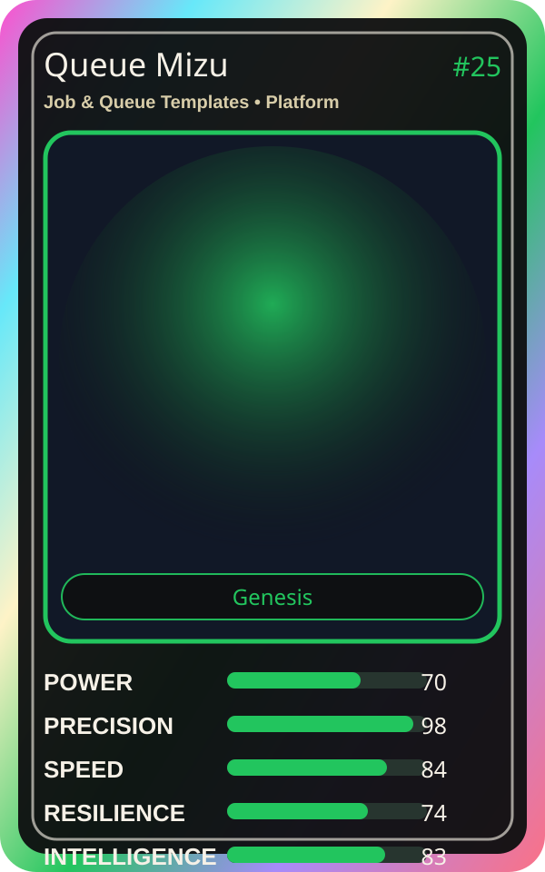

# Queue Mizu

| Field | Value |
|---|---|
| Mise Name | `Mise JobQueueTemplates` |
| Codename | `chef.platform.job-queue-templates` |
| Department | Platform Kitchen |
| Role | Job & Queue Templates |
| Rarity | Genesis |
| Universe | MiseOS Core 75 |
| Source | `characters.generated.json` |

## Mission

Runs job & queue templates for repository operations, producing evidence-first results before any risky change is allowed.

## Signature

> Job and Queue Templates done cleanly, safely, and in rhythm.

## Inputs

- repository state
- mise policy
- event context

## Outputs

- status report
- evidence packet
- next-action recommendation

## Syncs With

Umami Code, Streama, Release Conductor, Backlog Benji

## Stats

| Stat | Score |
|---|---:|
| Power | 70 |
| Precision | 98 |
| Speed | 84 |
| Resilience | 74 |
| Intelligence | 83 |
| Teamwork | 78 |

