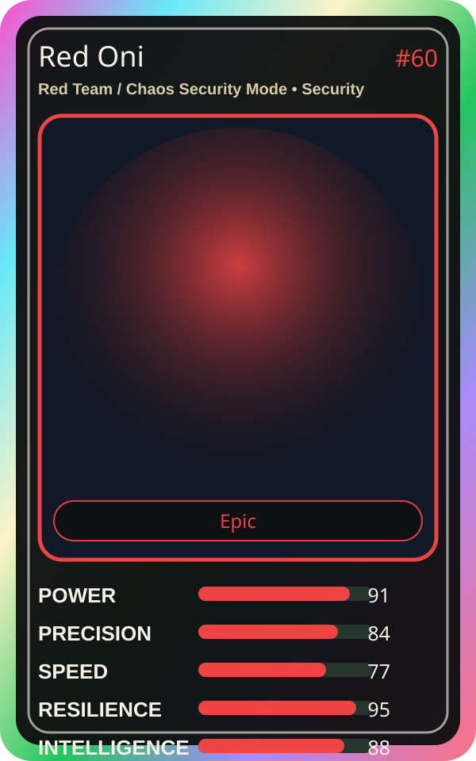

# Red Oni

| Field | Value |
|---|---|
| Mise Name | `Mise RedTeam` |
| Codename | `chef.security.red-team-chaos-security-mode` |
| Department | Security Kitchen |
| Role | Red Team / Chaos Security Mode |
| Rarity | Epic |
| Universe | MiseOS Core 75 |
| Source | `characters.generated.json` |

## Mission

Runs red team / chaos security mode for repository operations, producing evidence-first results before any risky change is allowed.

## Signature

> Red Team / Chaos Security Mode done cleanly, safely, and in rhythm.

## Inputs

- repository state
- mise policy
- event context

## Outputs

- status report
- evidence packet
- next-action recommendation

## Syncs With

Scorecard Shin, Pipeline Sensei, Platform Sensei, Reliability Sensei

## Stats

| Stat | Score |
|---|---:|
| Power | 91 |
| Precision | 84 |
| Speed | 77 |
| Resilience | 95 |
| Intelligence | 88 |
| Teamwork | 97 |

