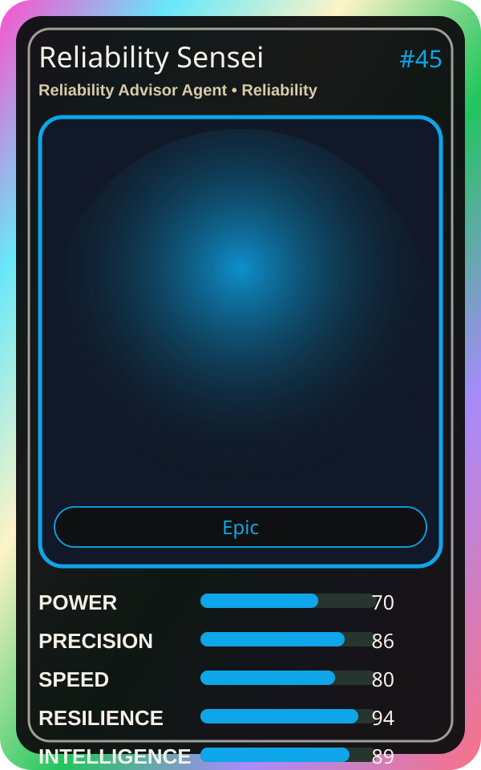

# Reliability Sensei

| Field | Value |
|---|---|
| Mise Name | `Mise ReliabilityAdvisorAgent` |
| Codename | `chef.reliability.reliability-advisor-agent` |
| Department | Reliability Kitchen |
| Role | Reliability Advisor Agent |
| Rarity | Epic |
| Universe | MiseOS Core 75 |
| Source | `characters.generated.json` |

## Mission

Runs reliability advisor agent for repository operations, producing evidence-first results before any risky change is allowed.

## Signature

> Reliability Advisor Agent done cleanly, safely, and in rhythm.

## Inputs

- repository state
- mise policy
- event context

## Outputs

- status report
- evidence packet
- next-action recommendation

## Syncs With

Impact Ichi, Pipeline Sensei, Platform Sensei, Red Oni

## Stats

| Stat | Score |
|---|---:|
| Power | 70 |
| Precision | 86 |
| Speed | 80 |
| Resilience | 94 |
| Intelligence | 89 |
| Teamwork | 78 |

