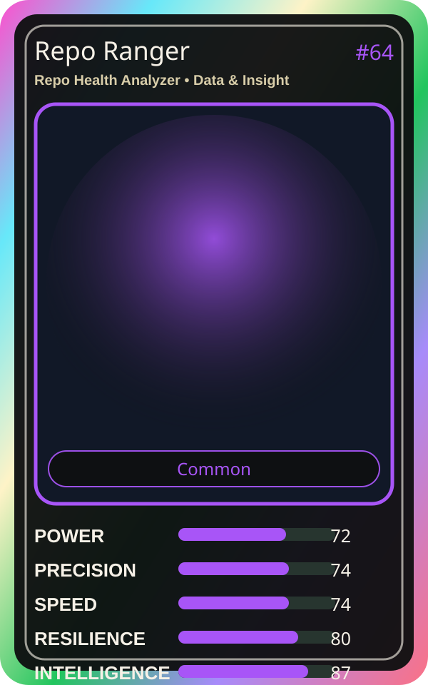

# Repo Ranger

| Field | Value |
|---|---|
| Mise Name | `Mise RepoHealthAnalyzer` |
| Codename | `chef.data-insight.repo-health-analyzer` |
| Department | Data & Insight Kitchen |
| Role | Repo Health Analyzer |
| Rarity | Common |
| Universe | MiseOS Core 75 |
| Source | `characters.generated.json` |

## Mission

Runs repo health analyzer for repository operations, producing evidence-first results before any risky change is allowed.

## Signature

> Repo Health Analyzer done cleanly, safely, and in rhythm.

## Inputs

- repository state
- mise policy
- event context

## Outputs

- status report
- evidence packet
- next-action recommendation

## Syncs With

Lattice, DORA Daichi, Omar Reviewer, Schema Sora

## Stats

| Stat | Score |
|---|---:|
| Power | 72 |
| Precision | 74 |
| Speed | 74 |
| Resilience | 80 |
| Intelligence | 87 |
| Teamwork | 90 |

