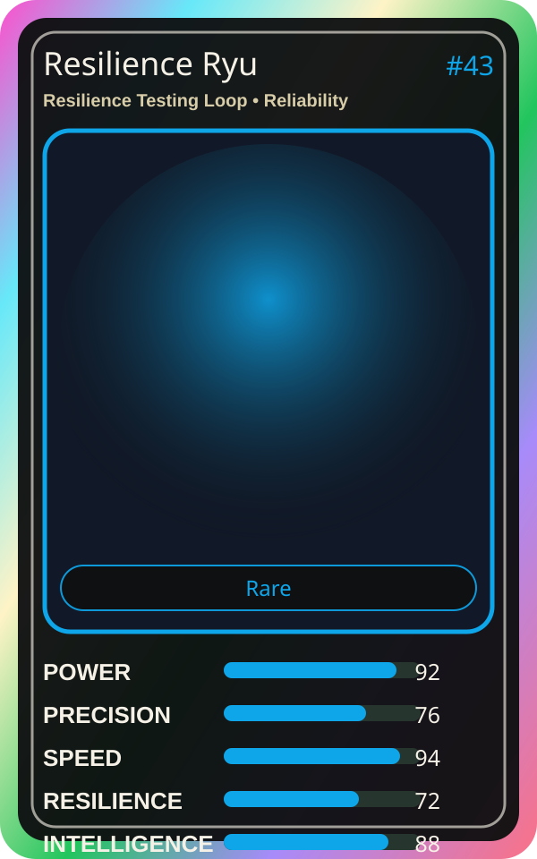

# Resilience Ryu

| Field | Value |
|---|---|
| Mise Name | `Mise ResilienceTestingLoop` |
| Codename | `chef.reliability.resilience-testing-loop` |
| Department | Reliability Kitchen |
| Role | Resilience Testing Loop |
| Rarity | Rare |
| Universe | MiseOS Core 75 |
| Source | `characters.generated.json` |

## Mission

Runs resilience testing loop for repository operations, producing evidence-first results before any risky change is allowed.

## Signature

> Resilience Testing Loop done cleanly, safely, and in rhythm.

## Inputs

- repository state
- mise policy
- event context

## Outputs

- status report
- evidence packet
- next-action recommendation

## Syncs With

Forecast Fuji, Impact Ichi, Ivun Cache, Portal Rei

## Stats

| Stat | Score |
|---|---:|
| Power | 92 |
| Precision | 76 |
| Speed | 94 |
| Resilience | 72 |
| Intelligence | 88 |
| Teamwork | 92 |

