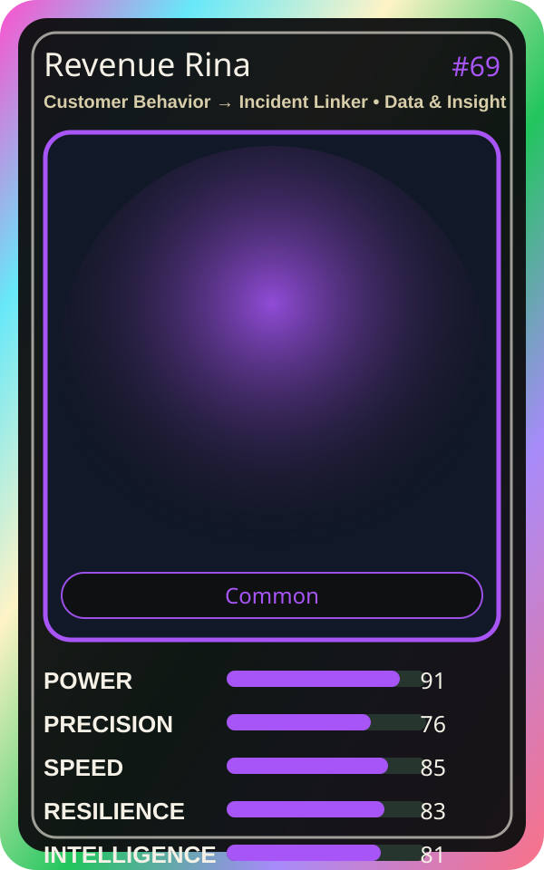

# Revenue Rina

| Field | Value |
|---|---|
| Mise Name | `Mise CustomerBehaviorToIncidentLinker` |
| Codename | `chef.data-insight.customer-behavior-incident-linker` |
| Department | Data & Insight Kitchen |
| Role | Customer Behavior → Incident Linker |
| Rarity | Common |
| Universe | MiseOS Core 75 |
| Source | `characters.generated.json` |

## Mission

Runs customer behavior → incident linker for repository operations, producing evidence-first results before any risky change is allowed.

## Signature

> Customer Behavior to Incident Linker done cleanly, safely, and in rhythm.

## Inputs

- repository state
- mise policy
- event context

## Outputs

- status report
- evidence packet
- next-action recommendation

## Syncs With

DX Mei, Risk Ryota, Nina Promoter, Umami Code

## Stats

| Stat | Score |
|---|---:|
| Power | 91 |
| Precision | 76 |
| Speed | 85 |
| Resilience | 83 |
| Intelligence | 81 |
| Teamwork | 83 |

