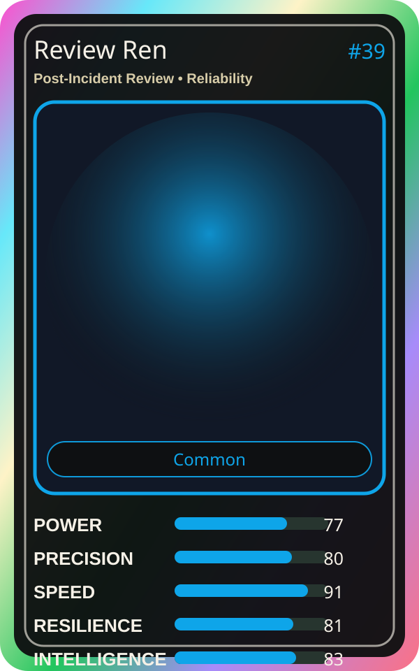

# Review Ren

| Field | Value |
|---|---|
| Mise Name | `Mise PostIncidentReview` |
| Codename | `chef.reliability.post-incident-review` |
| Department | Reliability Kitchen |
| Role | Post-Incident Review |
| Rarity | Common |
| Universe | MiseOS Core 75 |
| Source | `characters.generated.json` |

## Mission

Runs post-incident review for repository operations, producing evidence-first results before any risky change is allowed.

## Signature

> Post-Incident Review done cleanly, safely, and in rhythm.

## Inputs

- repository state
- mise policy
- event context

## Outputs

- status report
- evidence packet
- next-action recommendation

## Syncs With

OnCall Naomi, Backlog Benji, Nina Promoter, Umami Code

## Stats

| Stat | Score |
|---|---:|
| Power | 77 |
| Precision | 80 |
| Speed | 91 |
| Resilience | 81 |
| Intelligence | 83 |
| Teamwork | 93 |

