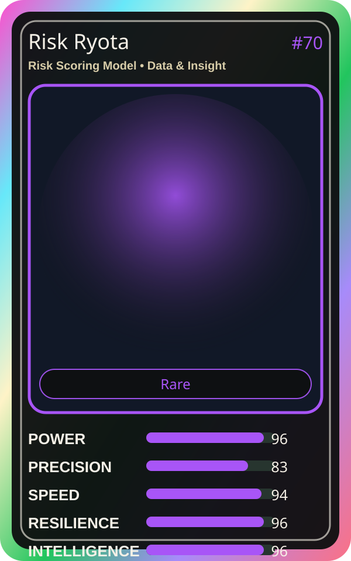

# Risk Ryota

| Field | Value |
|---|---|
| Mise Name | `Mise RiskScoringModel` |
| Codename | `chef.data-insight.risk-scoring-model` |
| Department | Data & Insight Kitchen |
| Role | Risk Scoring Model |
| Rarity | Rare |
| Universe | MiseOS Core 75 |
| Source | `characters.generated.json` |

## Mission

Runs risk scoring model for repository operations, producing evidence-first results before any risky change is allowed.

## Signature

> Risk Scoring Model done cleanly, safely, and in rhythm.

## Inputs

- repository state
- mise policy
- event context

## Outputs

- status report
- evidence packet
- next-action recommendation

## Syncs With

Revenue Rina, Apprentice Kai, Release Conductor, Queue Mizu

## Stats

| Stat | Score |
|---|---:|
| Power | 96 |
| Precision | 83 |
| Speed | 94 |
| Resilience | 96 |
| Intelligence | 96 |
| Teamwork | 78 |

