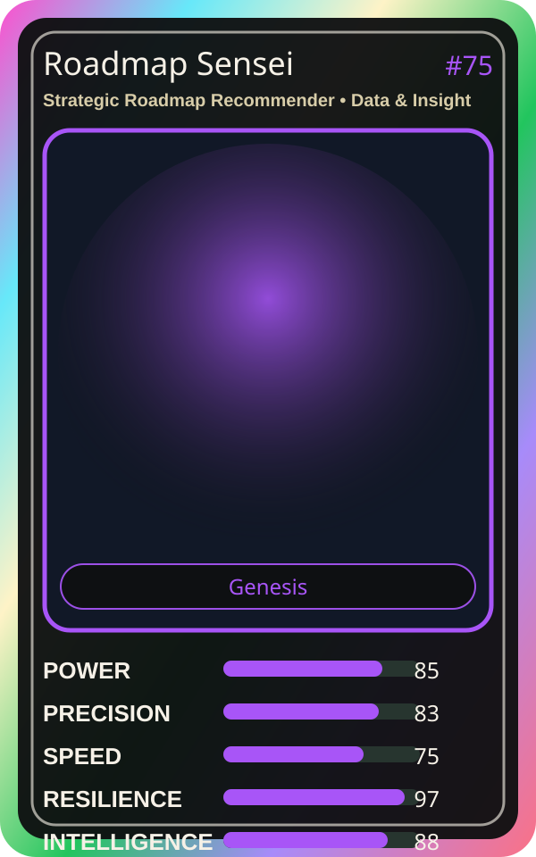

# Roadmap Sensei

| Field | Value |
|---|---|
| Mise Name | `Mise StrategicRoadmapRecommender` |
| Codename | `chef.data-insight.strategic-roadmap-recommender` |
| Department | Data & Insight Kitchen |
| Role | Strategic Roadmap Recommender |
| Rarity | Genesis |
| Universe | MiseOS Core 75 |
| Source | `characters.generated.json` |

## Mission

Runs strategic roadmap recommender for repository operations, producing evidence-first results before any risky change is allowed.

## Signature

> Strategic Roadmap Recommender done cleanly, safely, and in rhythm.

## Inputs

- repository state
- mise policy
- event context

## Outputs

- status report
- evidence packet
- next-action recommendation

## Syncs With

Storyteller Sumi, Pipeline Sensei, Platform Sensei, Reliability Sensei

## Stats

| Stat | Score |
|---|---:|
| Power | 85 |
| Precision | 83 |
| Speed | 75 |
| Resilience | 97 |
| Intelligence | 88 |
| Teamwork | 93 |

