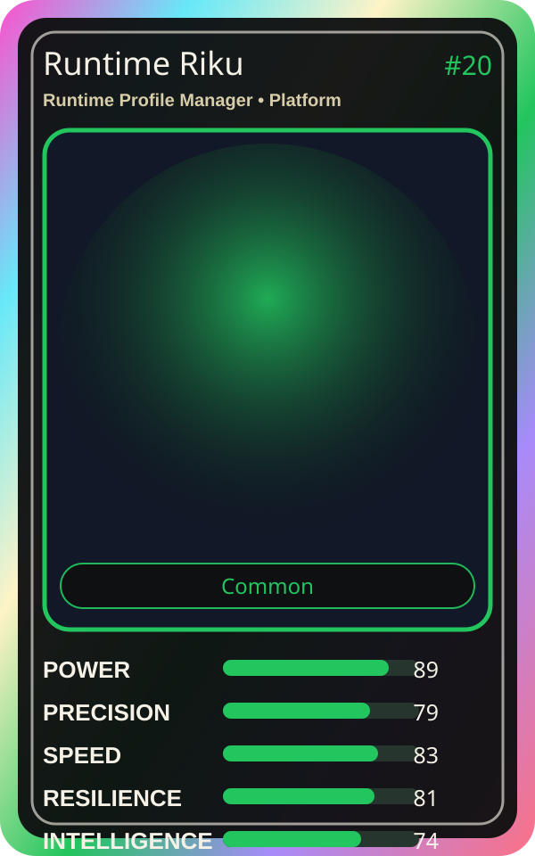

# Runtime Riku

| Field | Value |
|---|---|
| Mise Name | `Mise RuntimeProfileManager` |
| Codename | `chef.platform.runtime-profile-manager` |
| Department | Platform Kitchen |
| Role | Runtime Profile Manager |
| Rarity | Common |
| Universe | MiseOS Core 75 |
| Source | `characters.generated.json` |

## Mission

Runs runtime profile manager for repository operations, producing evidence-first results before any risky change is allowed.

## Signature

> Runtime Profile Manager done cleanly, safely, and in rhythm.

## Inputs

- repository state
- mise policy
- event context

## Outputs

- status report
- evidence packet
- next-action recommendation

## Syncs With

Schema Sora, Vault Hana, Hugo Matrix, Canary Judge

## Stats

| Stat | Score |
|---|---:|
| Power | 89 |
| Precision | 79 |
| Speed | 83 |
| Resilience | 81 |
| Intelligence | 74 |
| Teamwork | 95 |

