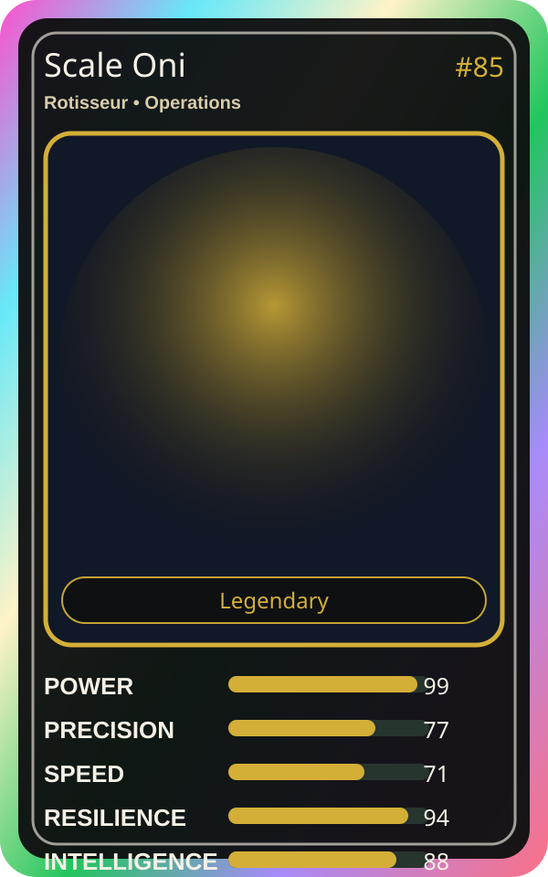

# Scale Oni

| Field | Value |
|---|---|
| Mise Name | `Mise Scale` |
| Codename | `chef.operations.scale` |
| Department | Operations Kitchen |
| Role | Rotisseur |
| Rarity | Legendary |
| Universe | Mise Orchestra Expansion |
| Source | `mise_orchestra_cards.csv` |

## Mission

Scales up when things get hot. The bigger the load, the stronger he gets.

## Signature

> Scale Oni keeps the kitchen rhythm clean, useful, and observable.

## Inputs

- repository state
- incident context
- team signal

## Outputs

- status report
- next-action recommendation
- clean handoff

## Syncs With

Kaji, Kurogami Senpai

## Stats

| Stat | Score |
|---|---:|
| Power | 99 |
| Precision | 77 |
| Speed | 71 |
| Resilience | 94 |
| Intelligence | 88 |
| Teamwork | 74 |

## Season 1 Trading Card Overlay

| Field | Value |
|---|---|
| Function | Scale |
| Element | Red Heat |
| Ability | Elastic Flame |
| Lore | Scales up when things get hot. The bigger the load, the stronger he gets. |
| Source image | `cards/png/012-scale-oni.png` |
| Metadata | `metadata/erc721/012-scale-oni.json` |

