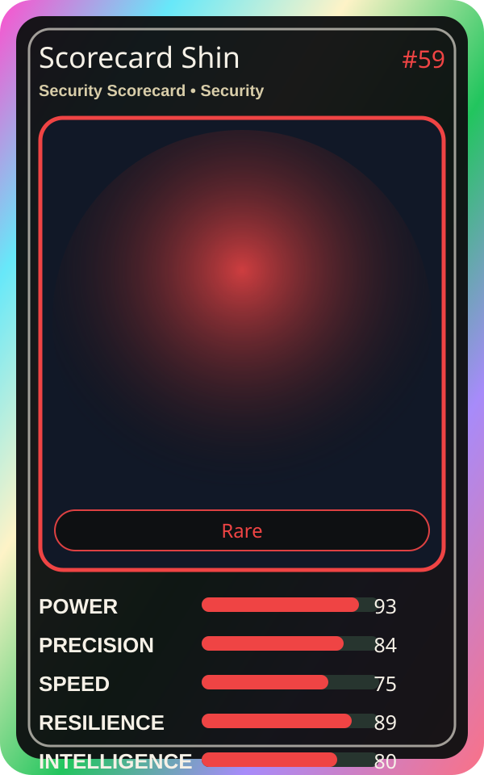

# Scorecard Shin

| Field | Value |
|---|---|
| Mise Name | `Mise SecurityScorecard` |
| Codename | `chef.security.security-scorecard` |
| Department | Security Kitchen |
| Role | Security Scorecard |
| Rarity | Rare |
| Universe | MiseOS Core 75 |
| Source | `characters.generated.json` |

## Mission

Runs security scorecard for repository operations, producing evidence-first results before any risky change is allowed.

## Signature

> Security Scorecard done cleanly, safely, and in rhythm.

## Inputs

- repository state
- mise policy
- event context

## Outputs

- status report
- evidence packet
- next-action recommendation

## Syncs With

Nudge Neko, Red Oni, Canary Taster, Guardrail Goro

## Stats

| Stat | Score |
|---|---:|
| Power | 93 |
| Precision | 84 |
| Speed | 75 |
| Resilience | 89 |
| Intelligence | 80 |
| Teamwork | 85 |

