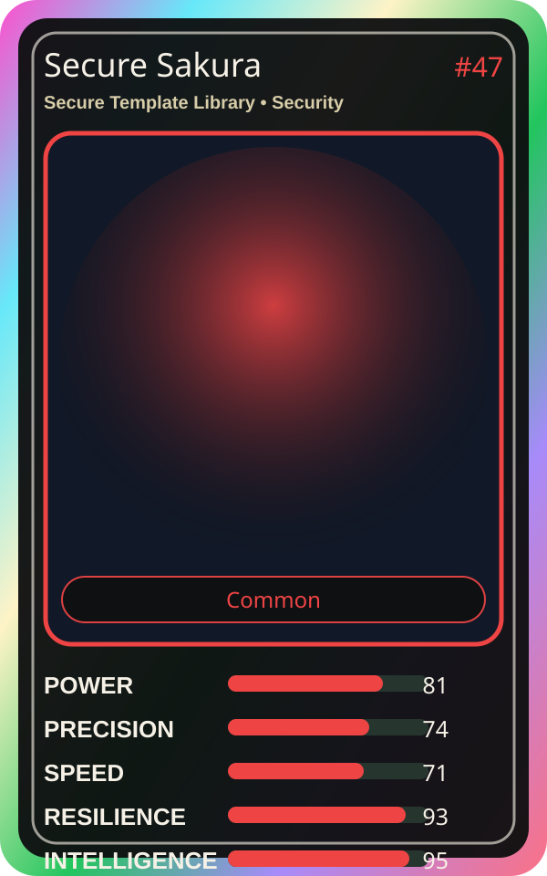

# Secure Sakura

| Field | Value |
|---|---|
| Mise Name | `Mise SecureTemplateLibrary` |
| Codename | `chef.security.secure-template-library` |
| Department | Security Kitchen |
| Role | Secure Template Library |
| Rarity | Common |
| Universe | MiseOS Core 75 |
| Source | `characters.generated.json` |

## Mission

Runs secure template library for repository operations, producing evidence-first results before any risky change is allowed.

## Signature

> Secure Template Library done cleanly, safely, and in rhythm.

## Inputs

- repository state
- mise policy
- event context

## Outputs

- status report
- evidence packet
- next-action recommendation

## Syncs With

Threat Taro, Token Toshi, Bruno Blast-Radius, Bootstrap Aiko

## Stats

| Stat | Score |
|---|---:|
| Power | 81 |
| Precision | 74 |
| Speed | 71 |
| Resilience | 93 |
| Intelligence | 95 |
| Teamwork | 93 |

