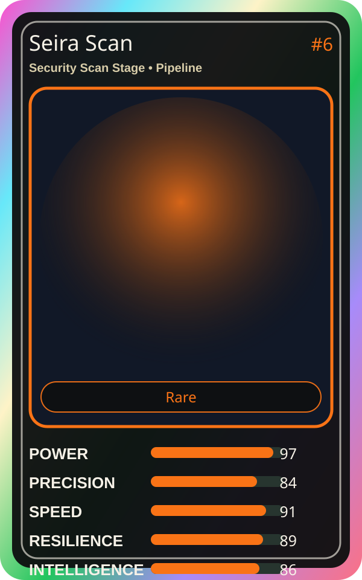

# Seira Scan

| Field | Value |
|---|---|
| Mise Name | `Mise SecurityScanStage` |
| Codename | `chef.pipeline.security-scan-stage` |
| Department | Pipeline Kitchen |
| Role | Security Scan Stage |
| Rarity | Rare |
| Universe | MiseOS Core 75 |
| Source | `characters.generated.json` |

## Mission

Runs security scan stage for repository operations, producing evidence-first results before any risky change is allowed.

## Signature

> Security Scan Stage done cleanly, safely, and in rhythm.

## Inputs

- repository state
- mise policy
- event context

## Outputs

- status report
- evidence packet
- next-action recommendation

## Syncs With

Hugo Matrix, Yume Builder, Vault Hana, Alert Akira

## Stats

| Stat | Score |
|---|---:|
| Power | 97 |
| Precision | 84 |
| Speed | 91 |
| Resilience | 89 |
| Intelligence | 86 |
| Teamwork | 91 |

