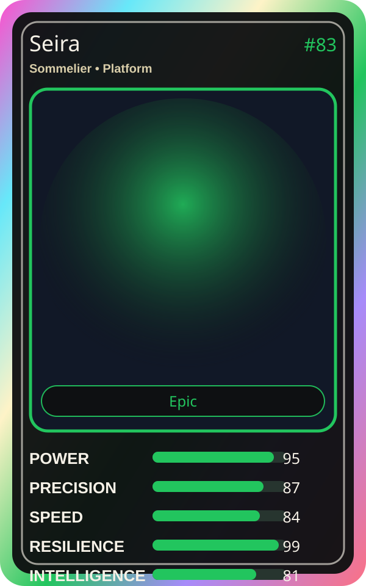

# Seira

| Field | Value |
|---|---|
| Mise Name | `Mise Secure` |
| Codename | `chef.platform.secure` |
| Department | Platform Kitchen |
| Role | Sommelier |
| Rarity | Epic |
| Universe | Mise Orchestra Expansion |
| Source | `mise_orchestra_cards.csv` |

## Mission

Protects secrets like fine wine. Security is her specialty.

## Signature

> Seira keeps the kitchen rhythm clean, useful, and observable.

## Inputs

- repository state
- incident context
- team signal

## Outputs

- status report
- next-action recommendation
- clean handoff

## Syncs With

Platform Sensei, Kuro Guard

## Stats

| Stat | Score |
|---|---:|
| Power | 95 |
| Precision | 87 |
| Speed | 84 |
| Resilience | 99 |
| Intelligence | 81 |
| Teamwork | 95 |

## Season 1 Trading Card Overlay

| Field | Value |
|---|---|
| Function | Secure |
| Element | Secret Wine |
| Ability | Vault Pairing |
| Lore | Protects secrets like fine wine. Security is her specialty. |
| Source image | `cards/png/010-seira.png` |
| Metadata | `metadata/erc721/010-seira.json` |

