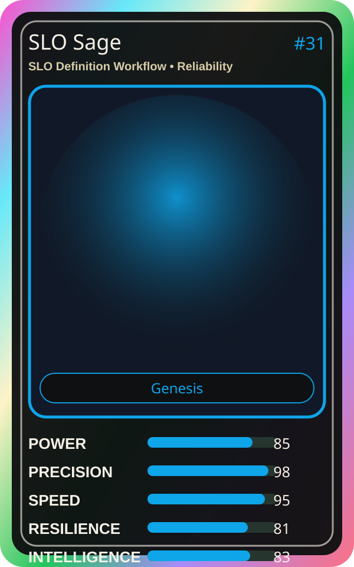

# SLO Sage

| Field | Value |
|---|---|
| Mise Name | `Mise SloDefinitionWorkflow` |
| Codename | `chef.reliability.slo-definition-workflow` |
| Department | Reliability Kitchen |
| Role | SLO Definition Workflow |
| Rarity | Genesis |
| Universe | MiseOS Core 75 |
| Source | `characters.generated.json` |

## Mission

Runs slo definition workflow for repository operations, producing evidence-first results before any risky change is allowed.

## Signature

> SLO Definition Workflow done cleanly, safely, and in rhythm.

## Inputs

- repository state
- mise policy
- event context

## Outputs

- status report
- evidence packet
- next-action recommendation

## Syncs With

Trace Sensei, Alko Commit Chef, Template Tanaka, Threat Taro

## Stats

| Stat | Score |
|---|---:|
| Power | 85 |
| Precision | 98 |
| Speed | 95 |
| Resilience | 81 |
| Intelligence | 83 |
| Teamwork | 81 |

## Season 1 Trading Card Overlay

| Field | Value |
|---|---|
| Function | Guarantee |
| Element | Error Budget |
| Ability | SLO Ward |
| Lore | Protects the promises. Maintains SLOs and error budgets. |
| Source image | `cards/png/018-slo-sage.png` |
| Metadata | `metadata/erc721/018-slo-sage.json` |

