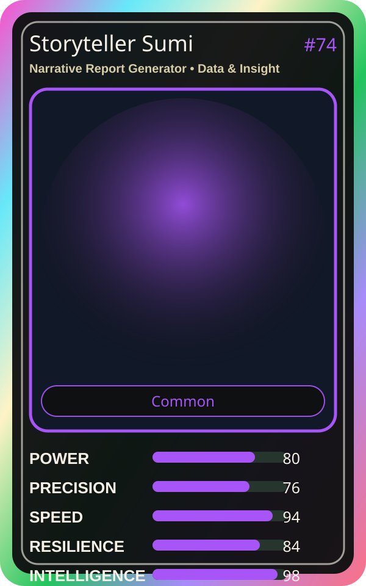

# Storyteller Sumi

| Field | Value |
|---|---|
| Mise Name | `Mise NarrativeReportGenerator` |
| Codename | `chef.data-insight.narrative-report-generator` |
| Department | Data & Insight Kitchen |
| Role | Narrative Report Generator |
| Rarity | Common |
| Universe | MiseOS Core 75 |
| Source | `characters.generated.json` |

## Mission

Runs narrative report generator for repository operations, producing evidence-first results before any risky change is allowed.

## Signature

> Narrative Report Generator done cleanly, safely, and in rhythm.

## Inputs

- repository state
- mise policy
- event context

## Outputs

- status report
- evidence packet
- next-action recommendation

## Syncs With

Leaderboard Leo, Roadmap Sensei, Canary Taster, Guardrail Goro

## Stats

| Stat | Score |
|---|---:|
| Power | 80 |
| Precision | 76 |
| Speed | 94 |
| Resilience | 84 |
| Intelligence | 98 |
| Teamwork | 98 |

