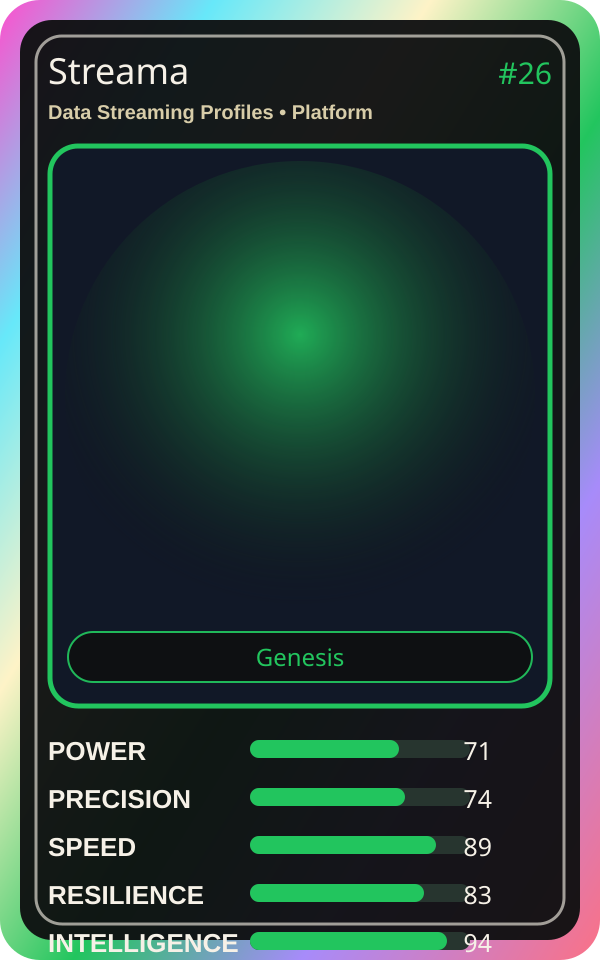

# Streama

| Field | Value |
|---|---|
| Mise Name | `Mise DataStreamingProfiles` |
| Codename | `chef.platform.data-streaming-profiles` |
| Department | Platform Kitchen |
| Role | Data Streaming Profiles |
| Rarity | Genesis |
| Universe | MiseOS Core 75 |
| Source | `characters.generated.json` |

## Mission

Runs data streaming profiles for repository operations, producing evidence-first results before any risky change is allowed.

## Signature

> Data Streaming Profiles done cleanly, safely, and in rhythm.

## Inputs

- repository state
- mise policy
- event context

## Outputs

- status report
- evidence packet
- next-action recommendation

## Syncs With

Queue Mizu, Preview Yuki, Felix Rollback, Metrics Miko

## Stats

| Stat | Score |
|---|---:|
| Power | 71 |
| Precision | 74 |
| Speed | 89 |
| Resilience | 83 |
| Intelligence | 94 |
| Teamwork | 93 |

## Season 1 Trading Card Overlay

| Field | Value |
|---|---|
| Function | Stream |
| Element | Live Water |
| Ability | Smooth Flow |
| Lore | Streams data like water. Smooth, continuous, and always flowing. |
| Source image | `cards/png/014-streama.png` |
| Metadata | `metadata/erc721/014-streama.json` |

