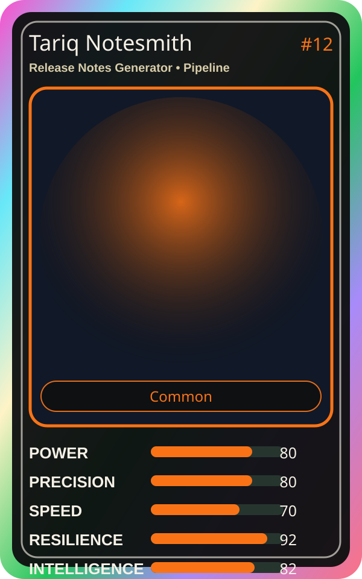

# Tariq Notesmith

| Field | Value |
|---|---|
| Mise Name | `Mise ReleaseNotesGenerator` |
| Codename | `chef.pipeline.release-notes-generator` |
| Department | Pipeline Kitchen |
| Role | Release Notes Generator |
| Rarity | Common |
| Universe | MiseOS Core 75 |
| Source | `characters.generated.json` |

## Mission

Runs release notes generator for repository operations, producing evidence-first results before any risky change is allowed.

## Signature

> Release Notes Generator done cleanly, safely, and in rhythm.

## Inputs

- repository state
- mise policy
- event context

## Outputs

- status report
- evidence packet
- next-action recommendation

## Syncs With

Felix Rollback, Ivun Cache, Preview Yuki, Forecast Fuji

## Stats

| Stat | Score |
|---|---:|
| Power | 80 |
| Precision | 80 |
| Speed | 70 |
| Resilience | 92 |
| Intelligence | 82 |
| Teamwork | 90 |

