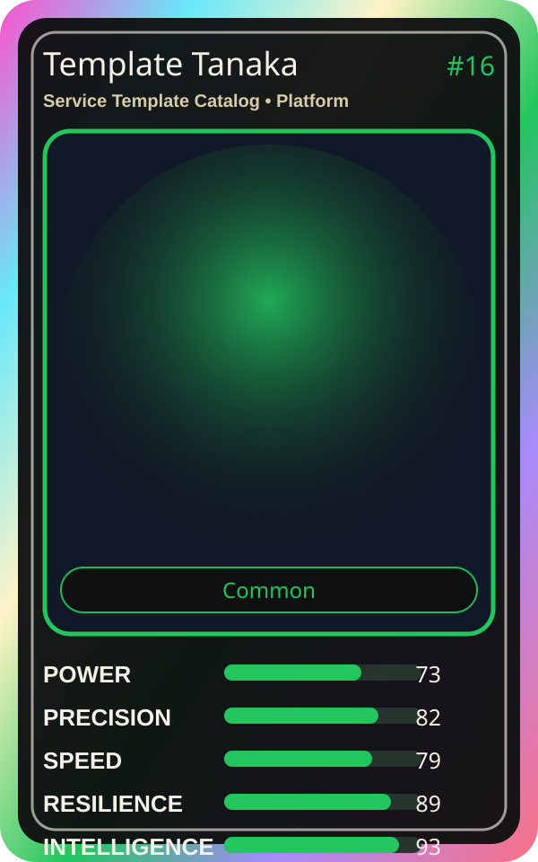

# Template Tanaka

| Field | Value |
|---|---|
| Mise Name | `Mise ServiceTemplateCatalog` |
| Codename | `chef.platform.service-template-catalog` |
| Department | Platform Kitchen |
| Role | Service Template Catalog |
| Rarity | Common |
| Universe | MiseOS Core 75 |
| Source | `characters.generated.json` |

## Mission

Runs service template catalog for repository operations, producing evidence-first results before any risky change is allowed.

## Signature

> Service Template Catalog done cleanly, safely, and in rhythm.

## Inputs

- repository state
- mise policy
- event context

## Outputs

- status report
- evidence packet
- next-action recommendation

## Syncs With

Bootstrap Aiko, Alko Commit Chef, SLO Sage, Threat Taro

## Stats

| Stat | Score |
|---|---:|
| Power | 73 |
| Precision | 82 |
| Speed | 79 |
| Resilience | 89 |
| Intelligence | 93 |
| Teamwork | 95 |

