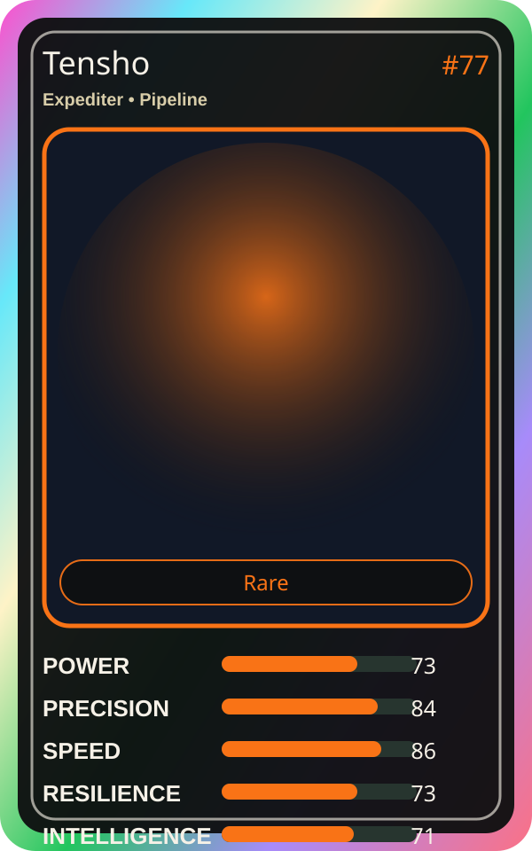

# Tensho

| Field | Value |
|---|---|
| Mise Name | `Mise Task Flow` |
| Codename | `chef.pipeline.task-flow` |
| Department | Pipeline Kitchen |
| Role | Expediter |
| Rarity | Rare |
| Universe | Mise Orchestra Expansion |
| Source | `mise_orchestra_cards.csv` |

## Mission

Keeps the orders flowing. Chaos cannot stop the rush.

## Signature

> Tensho keeps the kitchen rhythm clean, useful, and observable.

## Inputs

- repository state
- incident context
- team signal

## Outputs

- status report
- next-action recommendation
- clean handoff

## Syncs With

Pipeline Sensei, Yume

## Stats

| Stat | Score |
|---|---:|
| Power | 73 |
| Precision | 84 |
| Speed | 86 |
| Resilience | 73 |
| Intelligence | 71 |
| Teamwork | 97 |

## Season 1 Trading Card Overlay

| Field | Value |
|---|---|
| Function | Task Flow |
| Element | Rush Ticket |
| Ability | Order Synchronizer |
| Lore | Keeps the orders flowing. Chaos cannot stop the rush. |
| Source image | `cards/png/002-tensho.png` |
| Metadata | `metadata/erc721/002-tensho.json` |

