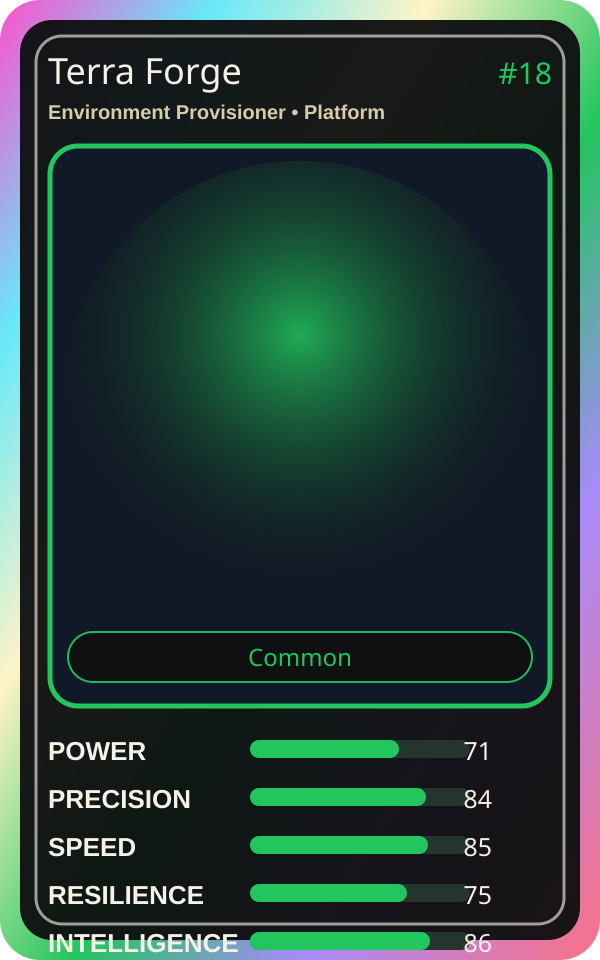

# Terra Forge

| Field | Value |
|---|---|
| Mise Name | `Mise EnvironmentProvisioner` |
| Codename | `chef.platform.environment-provisioner` |
| Department | Platform Kitchen |
| Role | Environment Provisioner |
| Rarity | Common |
| Universe | MiseOS Core 75 |
| Source | `characters.generated.json` |

## Mission

Runs environment provisioner for repository operations, producing evidence-first results before any risky change is allowed.

## Signature

> Environment Provisioner done cleanly, safely, and in rhythm.

## Inputs

- repository state
- mise policy
- event context

## Outputs

- status report
- evidence packet
- next-action recommendation

## Syncs With

Bootstrap Aiko, Schema Sora, Lila Branchkeeper, Chaos Kaito

## Stats

| Stat | Score |
|---|---:|
| Power | 71 |
| Precision | 84 |
| Speed | 85 |
| Resilience | 75 |
| Intelligence | 86 |
| Teamwork | 97 |

