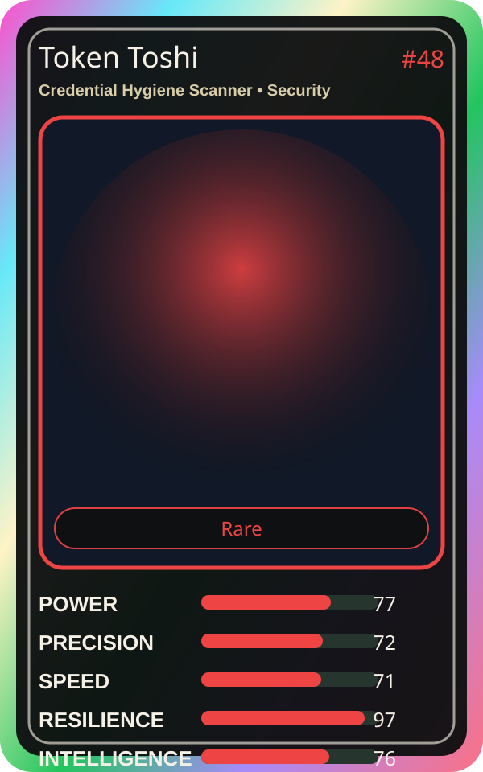

# Token Toshi

| Field | Value |
|---|---|
| Mise Name | `Mise CredentialHygieneScanner` |
| Codename | `chef.security.credential-hygiene-scanner` |
| Department | Security Kitchen |
| Role | Credential Hygiene Scanner |
| Rarity | Rare |
| Universe | MiseOS Core 75 |
| Source | `characters.generated.json` |

## Mission

Runs credential hygiene scanner for repository operations, producing evidence-first results before any risky change is allowed.

## Signature

> Credential Hygiene Scanner done cleanly, safely, and in rhythm.

## Inputs

- repository state
- mise policy
- event context

## Outputs

- status report
- evidence packet
- next-action recommendation

## Syncs With

Secure Sakura, CVE Kumo, Lila Branchkeeper, Terra Forge

## Stats

| Stat | Score |
|---|---:|
| Power | 77 |
| Precision | 72 |
| Speed | 71 |
| Resilience | 97 |
| Intelligence | 76 |
| Teamwork | 79 |

